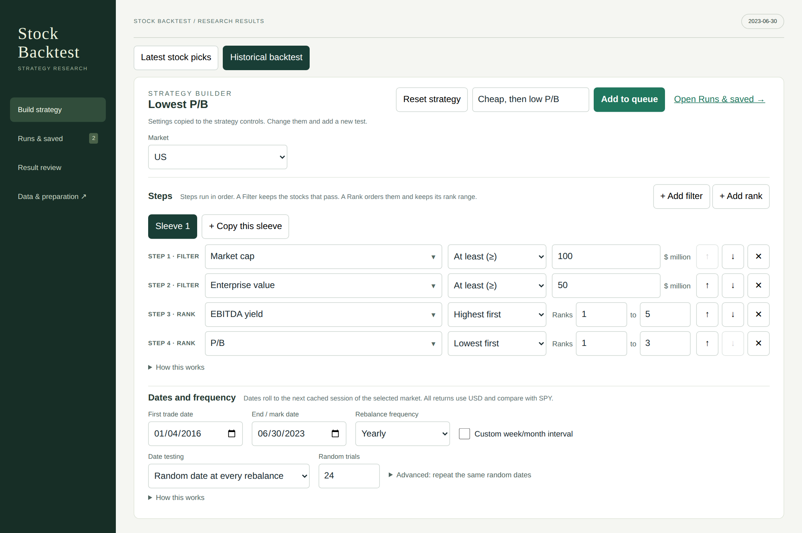
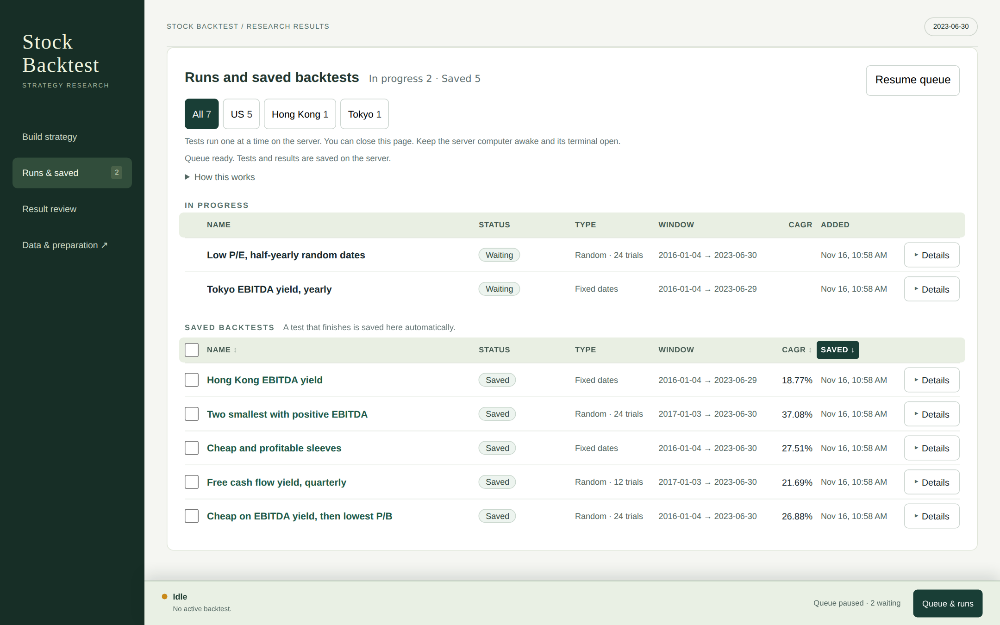
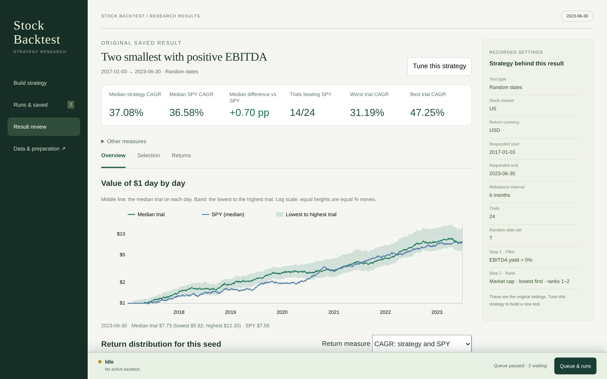
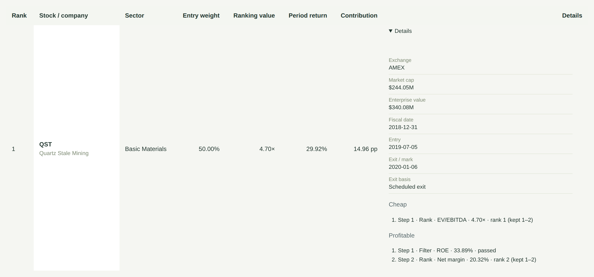
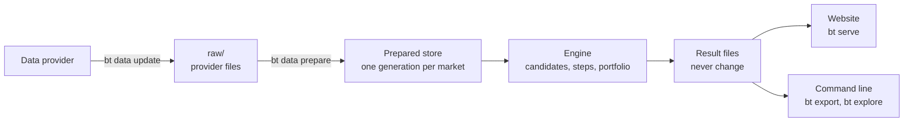

# Stock Backtest

A local research tool that screens stocks by valuation and backtests the picks against SPY.

[](https://github.com/hychowah/stock-backtest/actions/workflows/tests.yml)

Rust · TypeScript · runs on one computer

## What it does

Stock Backtest screens US, Hong Kong and Tokyo common stocks, one market at a
time. You build a strategy from filters and rankings, then either:

- see the **latest picks** for the most recent trading session, or
- run a **historical backtest** on fixed, random or explicit trade dates.

A backtest buys an equal-weight portfolio of the selected stocks at each
rebalance. It reports the return in US dollars and compares it with SPY,
including dividends. Everything runs on your own computer, from a local copy
of market data.

## Screenshots

The screenshots use the fictional companies and prices of the test data.

**Strategy builder:** four Filter and Rank steps, with the dates of a test.



**Runs and saved backtests:** two tests that wait in a paused queue, and five
saved results with their type, window and CAGR.



**Result review:** the answer first (here 14 of 24 random-date trials beat
SPY), then the value of $1 across the trials, with SPY.



**Step trail:** one holding's details, and how it passed the steps of two sleeves.



## Highlights

- **Strategy builder.** A strategy is one or more sleeves of ordered
  **Filter** and **Rank** steps. A Filter keeps the stocks that pass a
  condition. A Rank orders the survivors and keeps a rank range, such as 1–50.
  The picks of the sleeves join into one portfolio. Each holding shows its
  step trail: its value and outcome at every step.
- **Formulas and variables.** A step can read a formula over 59
  point-in-time inputs, 8 named measures and 35 built-in values, with yearly
  statistics (average, minimum, maximum, growth and CAGR over up to 10 yearly
  values) and look-backs. Variables are kept in a library. Each result stores
  its whole strategy, formulas included.
- **Random-date trials.** A test can run many seeded trials (24 by default
  on the website). Each trial trades on one random session in every interval.
  The result shows the spread of returns against SPY, not one lucky start
  date.
- **One list of runs.** Every website test runs from a queue. You can edit,
  hold, reorder or pause waiting tests. A finished test is saved in the same
  list. You can rename, lock, compare and delete saved tests. Opening a saved
  result never calculates it again.
- **Scripts.** The `bt` command runs a batch of strategy files on the same
  trade dates and exports tables for analysis
  ([command-line guide](docs/command-line.md)).

## How it works



The program downloads market data into local files, prepares them into one
store, and calculates each test from that store. A finished result is a file
that never changes; the website and the command line read the same results.
An update runs each night. [Development notes](docs/development.md) describe
the parts.

## Methodology essentials

- **Point-in-time reports.** A US annual report is used only from 90 days after
  its fiscal year-end. Hong Kong and Tokyo reports use their publication
  dates, otherwise four (Hong Kong) or three (Tokyo) months after year-end. A
  fiscal year-end more than 800 days old is too old to use. A newer report never
  fills a missing value.
- **No look-ahead by date.** A screen uses only reports, prices and FX rates
  dated on or before the screen date. In a backtest, a stock with no close
  that day enters at its first close up to 4 days later. Report values are FMP's current
  versions, not the original filings.
- **Dividend-adjusted prices.** Returns use dividend-adjusted prices.
  Enterprise value at entry uses the report's debt and cash and the entry
  price.
- **USD conversion.** All money, thresholds and returns are in US dollars.
  Foreign returns include currency moves, without hedging.
- **SPY total-return benchmark.** SPY includes dividends. Hong Kong and Tokyo
  dates use the previous completed US close.
- **Equal weights, no costs.** Every selected stock gets the same weight. There
  are no commissions, taxes or slippage. Cash earns 0%.
- **Delisted stocks included.** The US universe includes delisted names. If
  trading stops before the exit date, the last price is the exit.

See [docs/methodology.md](docs/methodology.md) for the full rules, the
original January study and its limits.

## Getting started

**Requirements**

- The Rust toolchain that `rust-toolchain.toml` names (rustup installs it).
- Node.js, to build the website.
- An FMP API key, only for data updates
  ([Updating the data](docs/command-line.md#updating-the-data) says where to
  put it). Backtests on saved data need no key.

**Build**

```bash
git clone https://github.com/hychowah/stock-backtest.git
cd stock-backtest
cargo build --release --locked -p bt
(cd web && npm ci && npm run build)
```

**Try it on fictional data**

The repository has no market data, but its test data is a small fictional
market: 10 US, 6 Hong Kong and 5 Tokyo companies, from December 2015 to June
2023. It needs no key:

```bash
mkdir -p tmp/try
cp -r fixtures/fictional/raw tmp/try/raw
ln -s "$PWD/web/dist" tmp/try/web
target/release/bt data prepare --home tmp/try
target/release/bt serve --home tmp/try
```

Open `http://127.0.0.1:3000`. Press Ctrl+C to stop the server.

**Daily use:** install the program with `./install.sh` and follow
[docs/running.md](docs/running.md).

## Documentation

- [Command-line guide](docs/command-line.md): the `bt` commands and strategy files.
- [Methodology](docs/methodology.md): the financial rules, the January study and its limits.
- [Parameter catalog](docs/parameter-catalog.md): each input and where it comes from.
- [Running the program](docs/running.md): installing, the nightly update, starting and stopping.
- [Development notes](docs/development.md): how the parts work, the layout and the tests.

## Limits

- **Not investment advice.** This is a personal research tool. A backtest
  describes the past and does not predict future returns.
- **Dividends in Hong Kong.** The handling has measured limits. See
  [Dividends](docs/methodology.md#dividends).
- **Tokyo is not updated.** Tokyo data can be prepared from saved files, but
  `bt data update` downloads only US and Hong Kong data.
- **No start from nothing.** An update needs a `raw/` that already holds the
  US or Hong Kong company list. The repository holds no market data.
- **One user.** The server has no login. It listens on this computer only and
  is made for one person.

---

© 2026 hychowah. All rights reserved.
