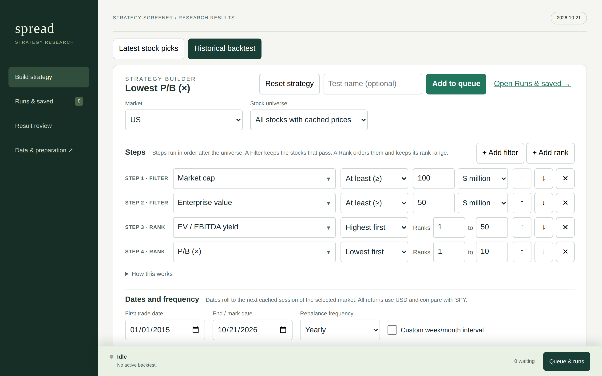
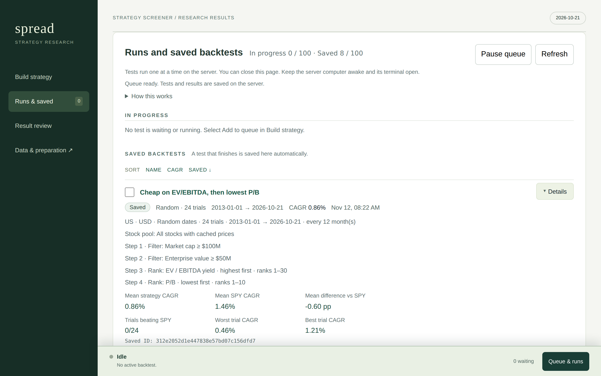
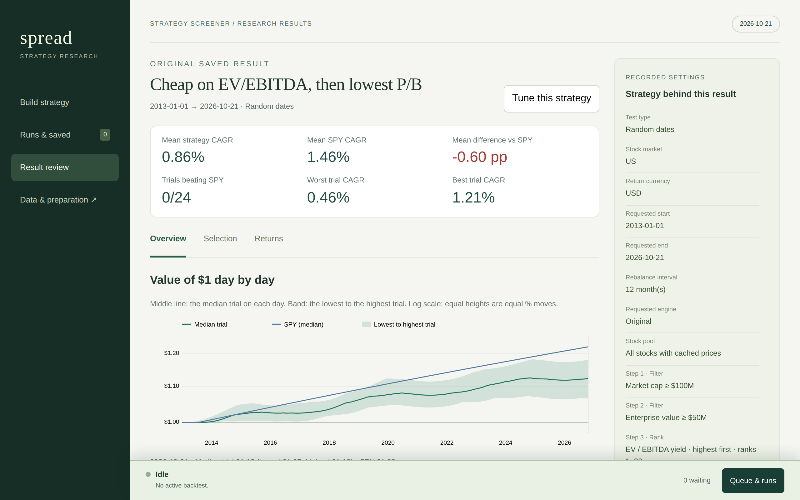
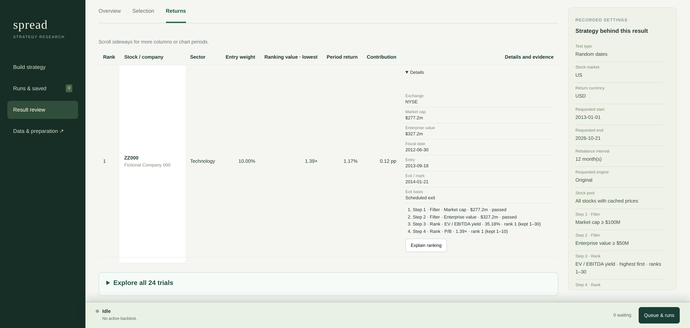
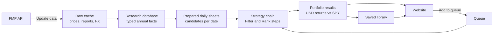

# Stock Backtest

A local research tool that screens stocks by valuation and backtests the picks against SPY.

[](https://github.com/hychowah/stock-backtest/actions/workflows/tests.yml)

Python standard library only · SQLite · plain browser JavaScript · no packages to install

## What it does

Stock Backtest screens US, Hong Kong and Tokyo common stocks, one market at a
time. You build a strategy from filters and rankings, then either:

- see the **latest picks** for the most recent trading session, or
- run a **historical backtest** on fixed or random rebalance dates.

A backtest buys an equal-weight portfolio of the selected stocks at each
rebalance. It reports the return in US dollars and compares it with SPY,
including dividends. Everything runs on your own computer, from a local cache of
market data.

## Screenshots

The screenshots use fictional companies and prices.

**Strategy builder:** a chain of Filter and Rank steps.



**Runs and saved backtests:** the queue, and each finished test with its settings.



**Result review:** the answer first, then the value of $1 across all random-date trials.



**Step trail:** how one holding passed each step.



## Highlights

- **Strategy builder.** A strategy is an ordered chain of **Filter** and
  **Rank** blocks, up to 50. A Filter keeps the stocks that pass a condition. A
  Rank orders the survivors and keeps a rank range, such as 1–50. Each selected
  stock shows its step trail: its value and outcome at every step.
- **Custom variables.** Write formulas over point-in-time annual facts: 55
  annual financial inputs, 33 named measures, and annual statistics such as mean,
  growth and CAGR. Saved variables keep every revision. Each run records the
  exact formula, so a result always reopens the same way.
- **Random-date robustness trials.** Run 1–100 seeded trials (24 by default).
  Each trial picks one random trading day in every rebalance period. The
  result shows the spread of returns against SPY, not one lucky start date.
- **Saved library and queue.** Every dated test runs from a queue. Edit, hold,
  reorder or pause waiting tests. Completed results move to a library of up to
  100 saved backtests. You can rename them, sort them and compare them
  side by side. Opening a saved result never recalculates it.
- **Incremental daily updates.** A data update downloads only what is new or
  missing. Preparation then recalculates only the affected companies and
  dates. Tests check that the result matches a fresh full build.

## How it works



The data panel downloads prices, annual reports, FX rates, SPY and Treasury
yields from Financial Modeling Prep (FMP) and saves each file once. Preparation
turns them into a SQLite database of typed annual facts, then into daily sheets
of candidate stocks. On each rebalance date the strategy chain selects from
that day's sheet. Portfolio results pair each period with SPY. Strategy
calculations never download data.

## Engineering notes

- **No dependencies.** The Python code uses only the standard library, which
  includes the HTTP server and SQLite. The browser code is plain JavaScript,
  with no framework and no build step. Node.js is used only to run the browser
  checks.
- **Point-in-time data, with tests.** A screen uses only what was known on its
  date. Tests check report availability dates, and that ranking never sees
  future returns
  ([tests/test_research.py](tests/test_research.py)).
- **Incremental updates equal a full rebuild.** A test changes a small cache
  in steps. After each step it compares every research table and every sheet
  with a fresh build, with floats compared bit for bit
  ([tests/test_market_inputs.py](tests/test_market_inputs.py)).
- **Safe writes and one lock order.** Saved files and databases are replaced
  atomically, so an interrupted write keeps the old file
  ([backtest/inputs/cache_assets.py](backtest/inputs/cache_assets.py)). Threads
  and server processes take locks in one documented order
  ([backtest/runtime/cache_access.py](backtest/runtime/cache_access.py)).
- **A durable queue and library.** Queued tests and saved results are stored
  apart from the caches that can be rebuilt, and the queue continues after a
  restart ([backtest/application/queue.py](backtest/application/queue.py)).
  Stored formats have versions, and tests keep old versions opening
  ([docs/durable-evidence.md](docs/durable-evidence.md)).
- **An independent reference engine.** A second implementation of the original
  study checks the main calculation code at full precision
  ([backtest/engines/reference/](backtest/engines/reference/)).
- **A fast, isolated test suite.** More than 1,000 Python tests and 25 Node.js
  checks run in about half a minute. The runner starts each file in its own
  process, and fails any test that touches local data
  ([tests/run.py](tests/run.py)).
- **Deployment with a journal.** The author's setup publishes one Git commit
  to a separate runtime folder. An unfinished publication blocks startup until
  a retry completes it ([tools/ops/deploy.py](tools/ops/deploy.py),
  [docs/workspaces.md](docs/workspaces.md)).

## Methodology essentials

- **Point-in-time reports.** A US annual report is used only from 90 days after
  its fiscal year-end. Hong Kong and Tokyo reports use reliable publication
  dates, otherwise four (Hong Kong) or three (Tokyo) months after year-end. A
  fiscal year-end more than 800 days old is too old to use. A newer report never
  fills a missing value.
- **No look-ahead by date.** A screen uses only reports, prices and FX rates
  dated on or before the screen date. Report values are FMP's current
  versions, not the original filings.
- **Dividend-adjusted prices.** Returns use dividend-adjusted prices.
  Enterprise value at entry uses the report's debt and cash and the entry
  price.
- **USD conversion.** All money, thresholds and returns are in US dollars.
  Foreign returns include currency moves, without hedging.
- **SPY total-return benchmark.** SPY includes dividends. Hong Kong and Tokyo
  dates use the previous completed US close.
- **Equal weights, no costs.** Every selected stock gets the same weight. There
  are no commissions or transaction costs. Cash earns 0%.
- **Delisted stocks included.** The US universe includes delisted names. If
  trading stops before the exit date, the last price is the exit.

See [docs/methodology.md](docs/methodology.md) for the original study, its
exit rules and its limits.

## Project layout

| Folder | Contents |
|---|---|
| `backtest/` | Financial rules, data preparation, selection, the calculation engine and the queue and library |
| `website/` | Browser interface, page builder and local HTTP server |
| `scripts/` | Command-line preparation and the development check |
| `tools/` | Deployment, operations and FMP API probes |
| `tests/` | Python and Node.js tests and the test runner |
| `docs/` | Methodology, design notes and the architecture guide ([index](docs/README.md)) |
| `results/` | Frozen January study record and experiment summaries |
| `raw/` | Local market-data cache (not tracked) |
| `data/` | Local databases, saved backtests and the queue (not tracked) |

**Where to start reading**

| File | What it shows |
|---|---|
| [backtest/selection.py](backtest/selection.py) | The filter and rank policy as one small module with no data access |
| [backtest/financial/rules.py](backtest/financial/rules.py) | The shared financial rules: report delay, report age and size floors |
| [backtest/calendar.py](backtest/calendar.py) | Rebalance-date planning with no input or output |
| [backtest/variables/definitions.py](backtest/variables/definitions.py) | Validation of the custom-variable formula language |
| [backtest/runtime/cache_access.py](backtest/runtime/cache_access.py) | Lock ownership across threads and server processes |
| [tests/run.py](tests/run.py) | The test runner and its local-data guard |

[docs/source-map.md](docs/source-map.md) lists which package owns each part of
the code.

## Getting started

**Requirements**

- Python 3, developed and tested with 3.14. The project uses only the standard
  library, so there is nothing to install with pip.
- Node.js, for the browser checks in the test suite.
- An FMP API key, only for downloads. Save it as a one-line text file at
  `~/.grok/secrets/fmp_api_key`. Backtests on saved data need no key.

**Run the tests first**

The repository has no market data. The tests build small synthetic data sets
and need no API key, so they are the quickest way to see the code work:

```bash
git clone https://github.com/hychowah/stock-backtest.git
cd stock-backtest
python3 tests/run.py
```

**Run the website**

```bash
python3 website/serve.py
```

The server listens on port 3000 (`--port` changes it) and opens your browser
at `http://127.0.0.1:3000`. Before it starts, it prepares any stale data and
rebuilds the page. With an empty cache it opens the data panel: choose
**Manage backtest data → Update data** to download market data.

The server has no login. By default it accepts connections from other
computers on your network. Add `--host 127.0.0.1` to accept connections from
this computer only.

A full data set needs time and disk space. With the US and Hong Kong files of
2026-11-09, the first preparation took about 10 minutes for the research
database (4.12 GB) and about 20 minutes for the daily sheets (10.8 GB), in
addition to the raw files. Later updates are incremental. See
[measured performance](docs/research-workflow.md#measured-performance).

Other commands:

```bash
python3 scripts/research.py prepare    # build the research database (no downloads)
python3 scripts/research.py status     # show database size and price coverage
python3 website/build.py               # rebuild the page into website/local/
python3 website/build.py --snapshot    # write a portable export to website/dist/
```

**Windows**

Run `backtest-web.cmd`, or double-click `start.cmd`. On a plain clone it runs
the same local server with native Python. Keep the terminal open; press Ctrl+C
to stop.

The author's setup develops in WSL and deploys committed source to a separate
native Windows runtime, which updates its data every day at 07:00 Hong Kong
time. See [docs/workspaces.md](docs/workspaces.md).

## Testing

```bash
python3 tests/run.py                 # fast tier (default)
python3 tests/run.py --tier heavy    # slow workloads
python3 tests/run.py --tier all      # both
```

The runner starts each `tests/test_*.py` and `tests/check-*.cjs` file in its
own process, eight at a time (`--jobs` changes this), with a private temporary
folder. It fails any test that touches the checkout's `data/` folder. Tests use
small synthetic data and need no API key. GitHub Actions runs the fast tier on
every push.

To run one file, call it directly, for example `python3 tests/test_queue.py` or
`node tests/check-queue.cjs`. After `python3 website/build.py`, also run
`node tests/check-range.cjs` and `python3 tests/check_screener.py`.

## Limits

- **Not investment advice.** This is a personal research tool. A backtest
  describes the past and does not predict future returns.
- **No trading costs.** Results have no commissions, taxes or slippage.
- **Restated reports.** Report values are FMP's current versions, not the
  original filings.
- **Dividends in Hong Kong.** The handling has measured limits. See
  [Dividends](docs/research-workflow.md#dividends).
- **One user.** The server has no login and is made for one person on a
  trusted network.

---

© 2026 hychowah. All rights reserved.
