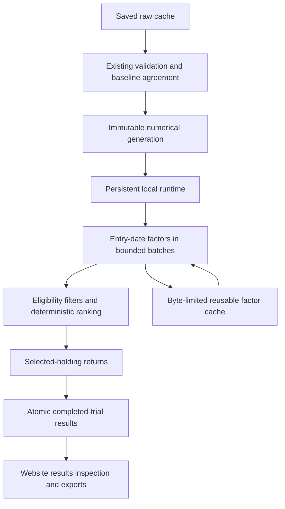

# Master plan for a faster stock backtest engine

Created: 23 October 2026.

Implementation workflow updated: 24 October 2026.

Status: workspace preparation CB-00 is implemented. No replacement calculation
engine has been implemented. Engine phases CB-01 through CB-15 remain planned,
including the measurement phase.

## Objective

Make random-date stock-screen research at least **5× faster**, with **10× or more as the target**, compared with the current production engine on the same machine, inputs, sampled dates and strategy settings.

The main workload is at least 24 random-date trials over **1997–2025**, usually with **12-month** rebalancing. The user changes filter settings between experiments. The intended interval range is **one week through two years**. Fresh random dates must benefit. Reusing a fixed seed must not be necessary for a speed claim.

Preserve holdings, ranks, valuations, returns, coverage, exit treatment and random-date experiment meaning. Keep the website, data panel, local launcher and offline research workflow usable. A complete engine replacement is permitted when evidence supports it.

This is a program-level plan. Each phase is scoped for one Codex 6.1-sol session. Each code phase must use `$strategic-design-plan` for its detailed code structure, then implement and verify the change, then use `$smart-commit`. The phase agent carries this sequence through automatically. It asks the user only for a critical blocker or a decision that cannot be resolved within the authorized scope. This document does not prescribe every module or function.

The [research findings and primary sources](research.md) explain the options and their limits. They are part of this plan.

## Decisions and open gates

| Subject | Program direction | Evidence still required |
|---|---|---|
| Calculation model | Compiled factor research engine. Separate entry-date screening from selected-holding returns. | Representative end-to-end prototype and full rule parity. |
| Data model | Immutable numeric inputs, sparse price histories, bounded entry-date factor batches. | Sparse versus dense access, measured memory and Windows mapping lifecycle. |
| Preferred implementation | Python orchestration with NumPy buffers and Numba native kernels. | Supported wheel set, cold-start behavior, invalidation and real workload speed. |
| Alternative implementation | A Rust numerical core using the same input/output contract. | Conditional comparison if Numba exposes a material limitation. |
| Database role | Keep verified research data and compact job/result storage. Remove per-candidate SQL traffic from calculation. | Publication and recovery measurements. |
| Polars and DuckDB | Optional bulk-preparation or batched-screening alternatives. | A measured advantage over a simple bulk export. Neither is mandatory initially. |
| Deployment | Persistent local runtime with bounded native parallelism. | Shutdown, generation replacement and memory tests on native Windows. |
| Weekly intervals | Add an explicit calendar extension. Proposed week means seven calendar days, with session rolling. | Freeze exact rules in CB-08 before exposing controls. |

Numba is a preferred candidate, not a conclusion that it beats Rust. The architecture must not depend on a particular compiler. Conversely, the program must not build and maintain two complete production engines. CB-02 and conditional CB-03 settle the backend before full integration.

The earlier recommendation to use Polars is refined here: it is useful when bulk preparation needs it. Existing validated SQLite inputs may already permit a sufficient streaming export. Avoid adding a second analytical dependency without a measured reason.

## Scope and boundaries

### Required outcomes

- Faster fixed-date and random-date calculations through one financial path.
- Both the original `legacy` pool and the broader `cached` pool.
- All current ranking metrics, threshold filters, rank ranges and metadata filters.
- Fresh dates, repeated filters, saved-result replay and completed-trial recovery.
- Explicit weekly and intermediate week/month intervals through two years.
- Correct selected-stock inspection, CSV downloads, progress and error behavior.
- Automatic preparation and dependency handling through the existing launcher.
- Native Windows qualification. Linux/WSL correctness remains required, but its timings are not the Windows baseline.

### Scope held outside this program

Do not change the investment strategy, annual availability assumption, universe coverage, bankruptcy classification or canonical report cutoff to obtain speed. Do not refetch available market data. Do not add brokerage execution, intraday simulation, transaction costs, cloud services or distributed computing.

January and latest website modes can keep their prepared database and standalone browser path. Replacing those paths is not a prerequisite for accelerating dated schedules. Their calculations and exports must continue to agree with the common policy and catalog.

Keep `scripts/revalue.py:calculate` independent. Do not make the reference call the replacement numerical engine. Keep canonical report/database publication under `scripts/baseline.py`.

## Target behavior and data flow

Preparation validates saved inputs and produces one immutable numerical generation. The local runtime attaches that generation. A job calculates the required entry-date inputs, applies filters and ranks stocks. It then calculates returns for the selected holdings and publishes completed trial evidence.

### Units of reuse

| Data or result | Identity | Lifetime |
|---|---|---|
| Base numerical inputs | Verified source and report generation, format version and policy dependencies | Until a new generation is published |
| Report-level inputs | Symbol, selected report, applicable history and policy version | Within that input generation |
| Entry-date factors | Generation, entry date, pool and available factor fields | Bounded memory cache; optional disk persistence only if measured |
| Selected portfolio result | Generation, exact entry/exit dates and complete selection configuration | Reusable completed result |
| Random experiment | Generation, policy version, exact sampled dates, settings and trial count | Durable completed-trial checkpoints |

Entry-date factors must not depend on a future exit. However, the current code has period-specific eligibility checks, including the actual entry date being before the exit. Apply these checks before ranking. Deferring return arithmetic must not defer eligibility until after selection.

Avoid a complete daily factor cube at startup and avoid a table of every possible entry/exit return. See the memory estimates in the research findings.

## Financial correctness contract

Treat the current source as the executable reference. Root `AGENTS.md` remains binding. Resolve discrepancies between old prose and code explicitly; do not quietly change results.

| Area | Required behavior |
|---|---|
| Reports | Fiscal year-end plus 90 days; strict `known < entry`; drop reports older than 800 days. Preserve eligible USD fields and conflict handling. |
| Original pool | Apply reported-size eligibility before selecting its annual report. Preserve the original single-year 250-candidate pre-price buffer and its stable tie order. |
| Broader pool | Use cached-price coverage. Do not label it the full historical universe or imply a complete manual early-stop review. |
| Valuation | Keep the existing selected valuation series and its fiscal/entry price tolerances. Preserve formula operation order and current rounding behavior. |
| Entry | Preserve forward valuation-price and adjusted-price searches, missing-price exclusion and actual entry-date checks. |
| Exit | Preserve the normal 10-day backward search, long last-price fallback, dates, status labels and `(entry year, symbol)` bankruptcy override. |
| Thresholds | Strict `lt` and `gt`; all conditions pass; display units; missing values fail only conditions needing them. Preserve signed cash flow and margins. |
| Financial ratios | Selected report only; current denominator rules; four positive EPS years for PEG; mean positive current/prior equity for ROE. |
| Ranking | Metric yield descending, candidate rank ascending with the current SQL null behavior, then symbol ascending. Preserve arbitrary supported rank ranges. |
| Returns | Equal weights use actual selected count. Keep stopped proceeds in cash until the next rebalance. Preserve calculation and aggregation order. |
| Experiments | Same random samples for an explicit seed; common-window cash before the first trade for both strategy and SPY; paired incomplete-trial exclusion. |
| Coverage | Keep short and empty periods visible. No full-period strategy CAGR when a selected period is empty. |

Use float64. Do not weaken `baseline.REL_TOL` or `ABS_TOL`, currently both `1e-12`. Symbols, ranks, dates, statuses, membership and missingness must match exactly. Compare unrounded numeric fields at the existing full-precision tolerance and report maximum differences. Preserve bitwise identity where current formulas already provide it.

Keep financial calculations under one owned policy/catalog path. Consumers must remain generic. A compiled backend is not permission to hand-code a different P/E, PEG or EBITDA formula in each runtime. A bounded extraction of numeric policy functions is permitted when the same functions remain callable by the scalar and compiled paths. The independent January reference must remain independent.

## Interval contract

Current fixed and random schedule controls support 1, 3, 6, 12 and 24 months. Weekly and other intermediate intervals are new behavior in this program.

The proposed extension uses explicit **week** or **month** units. One week is seven calendar days. Targets stay anchored to the original starting date. Monthly targets clamp month ends. Targets roll forward to saved SPY sessions; the final mark rolls backward. A month is not a fixed number of days. A week is not silently interpreted as five sessions.

CB-08 must freeze the accepted count ranges and compatibility mapping. The intended range includes one to 104 weeks and one to 24 months. Keep existing `months` requests and explicit-date inspection working. Introduce a versioned interval representation for new requests and saved configurations.

Random trials continue to sample one available SPY session independently from each nominal interval block. Preserve one final partial block and common-window cash. Deduplicate rolled fixed targets. Test holiday-heavy weeks, leap dates, month ends, very short adjacent random holding periods and empty session blocks. Do not present new weekly sampling as behavior already supported by the old planner.

## Performance acceptance

### Primary comparison

Use native Windows on the user's machine. Use 24 trials, 1997-01-01 through 2025-12-31, and a 12-month interval. If the saved SPY cache does not cover these endpoints, stop and report that condition rather than silently changing the window.

CB-01 freezes a manifest with explicit sampled date lists, not only seeds. Suggested reproducible seeds are 42, 20261022 and 20261023. Record all request defaults explicitly. Use both pools and three filter profiles:

| Profile | Purpose | Initial fixture settings |
|---|---|---|
| F0 | Ordinary selection | Current EV/EBITDA, ranks 1–50, current default cap/EV limits, no added thresholds |
| F1 | Annual financial filters | F0 plus P/B `< 3` and ROE `> 10` in display units |
| F2 | Trailing-price filters | F0 plus one-year and three-year trailing returns `> 0` |

These thresholds are engineering fixtures, not investment recommendations. Add a mixed-filter, three-year-ranking and top-100 case to qualification. Add a deliberately empty selection to correctness checks. The workload manifest should also retain any concrete user strategy settings supplied before CB-01 closes.

Require **at least 5× median end-to-end speedup in each of the six primary pool/profile cases**, with no numerical or membership disagreement. Target 10× or more. Report per-seed ratios and absolute times; do not hide a slow case in an overall average. If a case fails, keep the new engine opt-in and revise the design.

### Measurement rules

1. Freeze source identities, input generation, report hash, versions, CPU/thread counts and settings.
2. Run against isolated derived data under ignored `tmp/`. Never clear the user's real books to make a test fresh.
3. Give both engines identical base data and date samples. Each timed primary run starts without completed date-pair results or reusable entry-factor results. A loaded immutable base dataset is allowed for both.
4. Include validation performed during the request, selection, return calculations, staging, completed-trial saving, response encoding and local transport. Use the same HTTP harness or equivalent isolated adapter for both engines.
5. Separate first installation, source preparation, compiler-cold startup, restart with a compiled cache, and an already-running request. They are different measurements.
6. Alternate engine order across the three seed runs per case. Use the same power settings and avoid simultaneous benchmark jobs. Do not claim the OS cache was cold unless it was actually controlled.
7. Report fresh-date runs, same-date filter changes and exact-result replay separately. No replay-only speed claim satisfies the objective.
8. Record wall time, stage times, private memory, working set, peak thread/process counts, artifact size and written bytes. Explain any timing exclusions.

The six primary cases require 18 paired runs across the three seeds. Capture one baseline run per case first to check cost. Run the full matrix in resumable batches if needed. Do not silently reduce the protocol when a session ends.

### Capacity and operational checks

Qualify 100 annual trials, the existing month intervals, intermediate intervals, top-100/rank slices and the weekly extension. Use bounded old-engine explicit-date comparisons for new weekly numeric returns. Use independent calendar fixtures for weekly sampling. The old random planner cannot serve as the weekly sampling reference.

A 24-trial full-window weekly workload has roughly 36,000 holding periods. It must use bounded buffers and cancellation checkpoints. A 100-trial weekly workload is a capacity test; it is not necessary to generate an enormous old candidate database to claim annual speedup. Start with a short-window pilot and record an explicit runtime/disk cap before running it.

Target at most **4 GiB peak process working set** for the default 24-trial broader-pool job on the inspected dataset. Track private bytes and mapped residency separately. Bound the factor cache by bytes. Repeated filter runs must not cause unbounded growth. If the target is infeasible, document a measured memory budget before enabling the engine by default.

## Preparation and runtime safety

### Generation publication

Build numerical generations under an ignored local data directory. A generation has an explicit schema, source identity, policy/catalog signature, buffer hashes, dtype/shape information and stable ordering metadata. Export from already validated prepared inputs. Do not create a second raw-data validation policy.

Publish a new directory only after validation completes. Switch a small current-generation pointer atomically under `cache_access`. Keep the previous valid generation through failed or interrupted preparation. Never overwrite mapped buffers in place. Test interrupted writes and Windows access/sharing failures.

Bind to immutable base inputs, not the whole mutable daily database. Capture fingerprints after research preparation because preparation can update the canonical report. Unfinished baseline publication must continue to block readers.

### Freshness

Validate raw inputs fully during preparation and startup. A normal job should check the compact prepared-generation identity under the existing project coordinator. Downloads and repair operations must mark prepared inputs stale before releasing ownership, including cancellation after partial successful publication.

Direct edits outside the coordinated data tools need an explicit policy. Proposed policy: they are detected by the next full startup/preparation check and require rebuild before the new snapshot is used. This changes the current financial-file request scan. CB-12 must document that policy, preserve supported manual workflows, and test it before removing those scans. If the existing immediate-detection guarantee must be retained, use reliable change evidence plus a full-check fallback. Never simply omit validation.

### Resource ownership

Retain lock order: process-local reentrant lock, project file lock, then database handles, mappings and worker resources. Retain ownership through native work and final closure. Keep current cross-server serialization while changing the engine; independent concurrent jobs are not a prerequisite.

Use one native parallelism layer with a measured cap. Do not create a new process pool for every trial or a full data copy per worker. Use bounded chunks so progress and cancellation can occur between native calls. Closing the terminal must stop native work before releasing lifetime ownership.

Treat the numerical generation signature and compiled-code signature separately. The compiled signature covers imported policy code, catalog, relevant constants, bankruptcy inputs, runtime/compiler versions and target platform. Numba's own cache invalidation is insufficient by itself; see the research findings.

### Recovery and compatibility

Commit completed trial evidence atomically. Configuration identity includes exact dates, generation, policy version, pool, metric, filters, limits, interval and rank range. Preserve distinct trial identities when schedules happen to repeat. Never reuse a result from another generation.

Keep the old cache and reference calculation path available during rollout. Do not delete existing books to create the new store. Inspection of old saved experiments must either route to the compatible old path or require an explicit recomputation. Do not silently show current data as the old experiment's evidence.

## Phase map

CB-00 is the preparatory WSL/native-Windows workspace migration. Its design and
handoff are filed in `phases/CB-00.design.md` and `phases/CB-00.md`. It does not
implement the compiled calculation engine. Read that handoff before CB-01.

All engine phases are **planned**. CB-03 is conditional. The normal engine path has 14 sessions; the Rust investigation makes it 15. CB-00 is separate preparatory work. These are scope units, not promises about elapsed duration. Split a phase before implementation if its detailed plan cannot fit one session without leaving an unstable partial change.

| Phase | Single-session result | Depends on |
|---|---|---|
| CB-00 | WSL source and native Windows deployment workflow | User's split-workspace request |
| CB-01 | Reproducible current-engine baseline and frozen workloads | CB-00 and this plan |
| CB-02 | Representative compiled feasibility prototype and decision evidence | CB-01 |
| CB-03 | Conditional Rust or bulk alternative comparison | A documented CB-02 limitation |
| CB-04 | Immutable numerical artifact preparation and publication | Backend gate passed |
| CB-05 | Correct compiled date, report and price primitives | CB-04 |
| CB-06 | Complete metric and threshold calculations | CB-05 |
| CB-07 | Deterministic generic filtering and ranking | CB-06 |
| CB-08 | Weekly and intermediate interval contract and planner | CB-01; can precede CB-04 |
| CB-09 | Fixed/explicit-date portfolio evaluation with full parity | CB-07 and CB-08 |
| CB-10 | Random trials and atomic recovery evidence | CB-09 |
| CB-11 | Persistent runtime, bounded parallelism and lifecycle | CB-10 |
| CB-12 | Launcher, preparation and data-panel integration | CB-11 |
| CB-13 | Website/API integration, inspection and exports | CB-12 |
| CB-14 | Full numerical, operational and speed qualification | CB-13 |
| CB-15 | Default cutover, documentation and retained fallback | CB-14 passed |

### CB-01 Capture the baseline

**Outcome:** A later session can reproduce the current behavior and timing without using this conversation as evidence.

**Work:** Freeze sampled dates and primary settings. Capture source hashes, data generation and report hash. Extend the benchmark harness to use isolated derived caches and compare full holding evidence. Measure current request stages, source scanning, worker initialization, calculation, selection, publication and response delivery. Start with one pilot before the full matrix.

**Deliverables:** A tracked workload manifest, a compact baseline report, a benchmark command and a correctness-case inventory. Store bulky outputs and disposable databases in ignored `tmp/`. Record any skipped runs as pending.

**Verification:** Repeated explicit samples return the same selections and values. Production raw files, report/database pair and real completed books stay unchanged. Native Windows execution is recorded. The comparison has no hidden saved-book reuse.

**Handoff:** Exact commands, fixture identities, baseline timing matrix and the identified serial costs. Do not implement the replacement engine in this phase.

### CB-02 Prove the compiled architecture

**Outcome:** Evidence that the proposed calculation model can plausibly satisfy the objective before production integration.

**Work:** Build a benchmark-only numerical slice from bulk-read validated inputs. Include entry/report selection, default ranking, P/B and ROE, trailing-return filters, deterministic top-50 selection and stopped-stock returns. Use requested dates rather than a full daily factor cube. Run 24 annual trials on both pools. Check a short explicit-date weekly stress case. Include a compact completed-result write so a fast kernel cannot hide a slow persistence design.

**Deliverables:** An isolated prototype, numerical comparisons, native Windows timings, memory/load measurements, wheel/version evidence and a short backend decision. Prototype files must be clearly separated from production paths.

**Verification:** Compare every selected holding and intermediate input supported by the slice. Distinguish compiler-cold, mapped-input attach and warm fresh-date time. Demonstrate a cross-module policy change invalidates the compiled code. Prototype success does not count as full-catalog parity or final application qualification.

**Gate:** Proceed when the representative cases show at least 5× improvement at the comparable measured boundary, with an explicit budget for remaining integration costs. Otherwise, identify the remaining cost and revise the design. If the limitation is native compilation or deployment, trigger CB-03. If it is persistence or data layout, correct that design first.

**Handoff:** Choose the backend provisionally for production work. Freeze the typed-input and result boundary. List unsupported parts of the slice. Do not let prototype shortcuts become implicit production rules.

### CB-03 Investigate the alternative only if needed

**Outcome:** A backend decision supported by the same workload and numerical contract.

**Work:** Reimplement only the limiting numerical slice in Rust, or run a truly batched Polars/DuckDB comparison if the issue is analytical processing. Reuse CB-02 inputs and output checks. Measure Python/native transfer and build/restart behavior. Resolve financial formula ownership if the implementation language changes.

**Deliverables:** A bounded comparison and an accepted backend decision. Update later phase assumptions and dependency requirements. If this phase is unnecessary, record a reasoned skip in the program ledger.

**Verification:** No gain from changed data, float32, relaxed arithmetic, altered filters or omitted saving. Verify native Windows packaging. A faster microbenchmark is insufficient if transfer or deployment removes the advantage.

**Handoff:** One selected backend. Do not retain two production implementations by accident.

### CB-04 Prepare immutable numerical generations

**Outcome:** The runtime can open validated, versioned inputs without rebuilding Python object graphs.

**Work:** Define the artifact contract. Export prices, sessions, Treasury inputs, annual reports, financial inputs and company metadata in bounded streams. Preserve stable original-buffer order and symbol sort order separately. Store the selected valuation series and adjusted series without changing their missingness. Add atomic publication, manifest verification and previous-generation recovery.

**Deliverables:** Offline preparation and read-only attachment commands, ignored artifact paths, a documented format and corruption/publication checks. Use existing cache validation and baseline readiness checks.

**Verification:** Compare exported values, dates and order against prepared source tables. Test no-input-change reuse, damaged/truncated buffers, interrupted publication, moved project paths and Windows readers holding an old generation. No raw download and no canonical report change solely from export.

**Handoff:** Format version, generation identity rules, ownership/closure contract and measured artifact size/load cost. Leave automatic startup integration to CB-12.

### CB-05 Implement date report and price primitives

**Outcome:** Native lookups reproduce the financial engine's temporal behavior.

**Work:** Implement sparse price searches, missingness masks, report availability and pool-specific eligible-report selection. Prepare report-level reusable values where safe. Preserve calendar-day tolerances and both forward and backward searches. Keep native inputs numeric and read-only.

**Deliverables:** Tested primitives and an adapter usable by later factor calculations. Explain any scalar policy extraction needed to share behavior.

**Verification:** Compare with existing `price`, `latest_statement` and snapshot inputs across real symbols and adversarial fixtures. Cover exact availability dates, age boundaries, unavailable prices, non-SPY dates, gaps, different valuation/adjusted availability and very short holding intervals. Run on Windows and Linux.

**Handoff:** Lookup semantics and measured cost. No website change and no new investment rule.

### CB-06 Implement the complete metric catalog

**Outcome:** Entry-date factor batches reproduce every current ranking pair and threshold value.

**Work:** Keep a single owned registry for current and three-year EV/EBITDA and all 18 threshold fields. Separate report-only work from entry-price-dependent work. Prepare report histories once. Use generic field IDs and explicit validity. Calculate requested factor dependencies in bounded batches; measure whether eager calculation of the small catalog is faster before optimizing further.

**Deliverables:** Full-catalog factor calculation, display metadata compatibility, dependency/version evidence and bounded factor-cache identity.

**Verification:** Differential tests against `metrics.evaluate` and `metrics.filter_values`. Include missing annual years, repeated report variants, USD conflicts, negative cash flow/margins, positive-denominator rules, PEG, ROE and leap-day trailing returns. Confirm that unneeded missing fields do not exclude a stock. Preserve current mean rounding and unrounded comparisons.

**Handoff:** Catalog coverage table, maximum numerical differences and factor-memory measurements. Consumers must not reconstruct formulas.

### CB-07 Implement generic filtering and ranking

**Outcome:** The compiled screener selects the same ordered stocks as SQL.

**Work:** Apply pool and period eligibility, limits, metadata filters, all threshold conditions and ranking through generic prepared fields. Reproduce the original pre-price buffer and its ties. Implement the exact final total ordering and requested rank slice. Begin with a correct deterministic sort; add partial selection only with measured need and tie proofs.

**Deliverables:** A selector with the existing request-validation semantics and SQL/browser comparison support.

**Verification:** Compare both pools, both ranking metrics, ranks 1–50, 1–100 and 51–100. Test null candidate ranks, tied cutoff values, duplicate scores, strict threshold boundaries, short/empty selections and invalid requests. Include near-exit entry eligibility before selection. Existing SQL and browser parity checks remain valid.

**Handoff:** A selector that consumes values without knowing their formulas. Record any deliberate validator-interface change.

### CB-08 Add weekly and intermediate intervals

**Outcome:** Fixed and random planners share an explicit calendar contract over the requested interval range.

**Work:** Freeze the week/month representation and accepted counts. Extend anchored boundaries and random blocks without changing existing month samples for existing requests. Keep explicit-date evaluation independent of how dates were generated. Version saved configuration conversion and reject ambiguous requests.

**Deliverables:** Calendar implementation, fixtures for all supported interval units and documented old-request mapping. Do not expose incomplete website controls yet.

**Verification:** Existing seeds and month configurations retain exact samples. Check one/two-week blocks, intermediate months, 24 months, leap days, holidays, duplicate rolled targets, partial final blocks and missing-session blocks. Verify common window bounds independently. Use deterministic calendars rather than financial engines to verify sampling rules.

**Handoff:** Frozen interval contract, configuration version and sample fixtures. This phase does not claim that the old planner supported weekly trials.

### CB-09 Evaluate fixed and explicit-date portfolios

**Outcome:** One numerical path turns selected stocks into complete dated portfolio results.

**Work:** Calculate selected returns, stopped exits, weights, contributions, period coverage, compounded growth and SPY comparison. Preserve current output evidence needed for inspection. Keep period eligibility separate from deferred return arithmetic. Support old month schedules and new explicit weekly date lists.

**Deliverables:** Fixed and explicit-date evaluator plus a diagnostic adapter. Retain the existing reference route for comparison.

**Verification:** Full holding/date/value/status parity against current schedules on isolated inputs. Check January books against the verified baseline, all existing frequencies, week-length explicit periods, bankruptcy fixtures, empty/short books, common-window cash, final marks and contribution order. Preserve `1e-12` tolerances.

**Handoff:** Complete financial result schema and evidence that selected-only returns preserve membership. Do not add random-job persistence in this phase.

### CB-10 Run random trials with durable recovery

**Outcome:** Random experiments use the new evaluator and preserve completed work after interruption.

**Work:** Retain deterministic sample generation and server-generated default seeds. Plan unique requested entry dates and factor dependencies. Store summaries, exact sampled dates and selected holding evidence atomically per completed trial. Keep configuration and input-generation identities explicit. Reuse shared calculations without collapsing duplicate trial identities.

**Deliverables:** Random experiment driver, compact result/checkpoint storage, saved-trial inspection and replay support. Add retention controls or a documented bounded policy for result growth.

**Verification:** Same seeds and existing settings match current experiments. Incomplete trials remain visible and paired distributions agree. Simulate interruption before/during/after commit, duplicate sampled schedules, filter changes and input-generation changes. Retry reuses only matching completed work. A new seed remains the default.

**Handoff:** Recovery contract, storage-size measurements and real progress units. Remove candidate-row writes from this path; do not remove old user books.

### CB-11 Add the persistent bounded runtime

**Outcome:** One server reuses open numeric inputs and native code without unbounded memory or orphan work.

**Work:** Attach a generation once, prewarm required signatures and select one measured native parallelism strategy. Bound factor caches, task queues and batch sizes. Add cancellation between chunks, deterministic per-portfolio reductions, safe generation handoff and explicit closure. Preserve project-level cache ownership and terminal lifecycle.

**Deliverables:** Runtime resource owner, worker/thread cap, cache limits, stage diagnostics and shutdown protocol.

**Verification:** Serial and parallel results agree. Stress repeated filter changes, invalidation, aborted requests, Ctrl+C, launcher replacement and two local servers. Test Windows mapping release before deletion. Confirm no nested thread multiplication, stale compiled globals or cross-generation cache reuse. Measure peak working set and memory after repeated jobs.

**Handoff:** Chosen parallel policy, cancellation bound, memory budget and compiler-cache signature. Do not rely on garbage collection alone to release mapped files.

### CB-12 Integrate preparation startup and data control

**Outcome:** The normal launcher brings the new engine to a ready state automatically.

**Work:** Extend dependency preparation in order: recover/verify research publication, prepare compatible base data, publish the numerical generation, prepare native runtime and rebuild stale website output. Add a pinned tested dependency environment. Preserve panel recovery when raw inputs are missing. Integrate stale-generation evidence with every relevant successful or partial coordinated download/repair. Resolve and document the direct-edit freshness policy before removing repeated raw scans.

**Deliverables:** Launcher/data-panel integration, runtime/dependency instructions, compact generation checks and preparation status. Existing standard-library reference commands remain available without installing the new numerical stack.

**Verification:** Unchanged restart avoids re-export. Changed inputs trigger correct preparation. Baseline publication recovery still precedes readers. Test missing dependencies, supported/unsupported Python versions, unavailable package network, offline installed operation, moved paths, invalid raw data, partial downloads, rebuild failure and simultaneous local launches. Keep all existing lock and secret-safe logging behavior.

**Handoff:** Tested Windows launch command and offline behavior. Initial package installation is separate from market-data downloading; running a strategy must not fetch market data.

### CB-13 Integrate the website and API

**Outcome:** Users can run the replacement through the existing website, including the extended interval range.

**Work:** Route dated schedule and robustness requests through an explicit opt-in engine selection. Adapt NDJSON events and progress text to actual work units. Add week/month controls, versioned saved settings, trial inspection, exports and errors. Ensure old saved requests have a defined route. Keep January/latest/static fallback behavior intact.

**Deliverables:** Working local UI/API flow, browser checks and a documented rollback setting. Update the guide to distinguish opt-in source from the default running engine.

**Verification:** Exercise a complete 24-trial run, changing filters, seed replay, weekly settings, cancellation/disconnection, saved trial inspection, CSVs and empty selections. Check desktop/mobile presentation when browser tools are available. Run existing range, screener, robustness, contributions and data-panel checks as affected. Build local output only.

**Handoff:** API compatibility notes and browser evidence. Do not refresh or stage `website/dist/` as an incidental build action.

### CB-14 Qualify correctness speed and operations

**Outcome:** A reproducible decision to cut over or continue optimization.

**Work:** Run the complete primary paired benchmark matrix and report the per-case speed gates. Run catalog/rank/interval differential coverage, 100-trial annual stress and bounded weekly reference cases. Run candidate weekly capacity tests only after a safe pilot. Check cold/restart performance, repeated filters, recovery, memory and file growth. Repeat a measurement only when a failure or changed implementation justifies it.

**Deliverables:** Tracked qualification report with settings, hashes, versions, maximum numeric differences, raw-output locations, per-case timings and explicit gate verdicts. Update experiment documentation with the new evidence while retaining historical results.

**Verification:** All required correctness and operational checks pass on Windows. Primary cases each reach 5×. No speedup relies on warm selected-result caches, relaxed precision, missing filters or omitted persistence. Unverified cases remain explicit and cannot support a broad claim.

**Handoff:** Pass/fail table. If a gate fails, leave the engine opt-in and write the smallest evidence-led follow-up phase. Do not label the program complete.

### CB-15 Cut over and close the program

**Outcome:** The qualified engine is the default for dated backtests, with clear recovery and fallback instructions.

**Work:** Change the default only after CB-14 passes. Remove temporary prototype integration and obsolete default routing. Retain the reference/rollback path and old caches through a documented migration period. Update README, workflow, data documentation, root instructions and the architecture guide to the implemented state. Document adding metrics, extending data, rebuilding generations, inspecting saved trials and rolling back.

**Deliverables:** Default route, final user guide and program completion record. Record actual 5×/10× results by workload. Keep unachieved targets explicit.

**Verification:** Native Windows launcher smoke test, representative browser flow, offline operation and the required regression checks. Confirm the canonical report is unchanged unless a separately verified data revision explains it. Confirm old books and raw data remain available. Compare the complete commit diff with the architecture guide.

**Handoff:** Final commands, qualified dependency versions, measured operating limits, rollback procedure and remaining limitations. No automatic hosted publication or portable snapshot refresh is part of this phase.

## Automatic agent implementation protocol

This protocol applies to every phase, including benchmark and preparation tooling. Once the user requests a phase, that request authorizes its complete **design → implement → verify → smart-commit** sequence. Do not stop after presenting a design, proposing edits, passing tests or offering to commit. Do not ask for approval between these steps when the work remains within the phase and the program's constraints.

The current request updates this plan. It does not start CB-01 or the rest of the implementation program.

### Start each session

Read root `AGENTS.md`, this plan, the research findings and the preceding phase record. Inspect current Git status using `.git-local`. Preserve unrelated work, including existing portable-snapshot changes. Read only the files needed for that phase. Do not open the parent harness.

Confirm the prerequisite gates passed and record the phase's intended file scope. If scope no longer fits one session, split it in this master plan before starting a partial integration. An agent can make a routine split that preserves the objective, ordering and acceptance criteria without asking the user. Do not infer completion from a phase heading or from a prototype's existence.

### Step 1 Run the detailed design skill

For code changes, invoke `$strategic-design-plan` with the selected phase as the brief. Supply its outcome, constraints, relevant current code, preceding decisions and verification requirements. Use the skill's independent planner and read-only workflow. Do not substitute the implementing agent's own design for the required planner report.

Print the returned report exactly as the skill requires. Once that read-only skill stage returns, the phase coordinator files the report verbatim at `docs/plans/compiled-backtest/phases/CB-xx.design.md`. This is the caller recording the report; the planner does not edit repository files. Record resolved requirements and routine choices separately in the phase record. Do not rewrite the planner's report to make it look accepted.

Proceed directly to implementation when the design fits the authorized phase. If a material code-structure change becomes necessary, rerun the design skill with the revised brief and preserve the superseded report as evidence. A routine repair that does not change the agreed structure does not need a new design cycle.

For a phase or subtask that changes only prose, captures measurements with existing tools, or records a backend decision without code changes, the design skill is outside scope. Record why that step does not apply and continue the remaining sequence automatically. Do not invent code work to force a design report.

### Step 2 Implement the phase

Implement the agreed structure and the scoped outcome. Make ordinary implementation choices autonomously. Use measured evidence to select a backend, trigger or skip CB-03, choose bounded buffers, and adjust task order within the dependency graph. Record these decisions and their reasons; they do not require a user approval round.

Preserve the financial correctness contract, benchmark gates, source data, canonical report integrity and unrelated changes. Keep all introduced helpers and API consumers consistent. Update affected documentation and the architecture guide with the implementation, not in a later cleanup phase.

### Step 3 Verify and repair

Run the phase's required checks, including native Windows checks where specified. Read failures, apply clear repairs and rerun affected checks until they pass. Dependency repair and bounded isolated experiments are part of the phase. Do not ask the user to run a routine preparation command or approve each test repair.

A failed speed gate is engineering evidence. Investigate its cause, improve the authorized design or run the planned alternative comparison automatically. Keep the gate failed until the evidence passes. Ask the user only when progress requires a critical scope, correctness, resource or acceptance decision. Do not lower the speed target, weaken tolerance, omit a filter or claim an unrun check passed.

Complete the phase record and status evidence before the commit audit. If required verification cannot finish, record the unfinished checks and their cause. Do not commit a phase as complete or start a dependent phase while a required gate remains unresolved.

### Step 4 Run smart-commit

Invoke `$smart-commit` after implementation and verification. Give its independent auditor the phase scope, baseline dirty-file list, design report, changed documentation and required checks. Follow its audit, finding review, clear-fix and verification steps. Do not use a self-audit as a substitute for the required auditor.

Resolve findings supported by existing authorization without another user approval. For example, the root snapshot rule already resolves exclusion of unrelated `website/dist/` changes. If a finding needs a genuine user decision and remains unresolved, obey the skill's confirmation gate and do not stage or commit. Do not reclassify a critical policy choice merely to force automation.

When the gate is clear, commit the coherent phase automatically. Include the filed design report, phase record, ledger change, code, tests and relevant documentation in that phase's commit. Use a subject containing the phase ID. Keep unrelated changes unstaged. Do not push, publish, amend previous commits, bypass hooks or stage a portable snapshot unless the user separately authorizes that action.

The phase record need not contain its own commit hash. It belongs to the same commit as the implementation. Report the actual hash after the commit and let the next session verify it from Git. Do not create a second bookkeeping commit just to insert that hash.

### Critical blockers and user decisions

An agent should ask the user when it cannot safely continue without one of the following:

- A change to financial meaning, universe coverage, freshness guarantees, numerical tolerance or an acceptance target.
- A material expansion of scope, paid service, destructive data action or unresolved ownership of changes.
- A tradeoff with materially different user outcomes that the program and evidence do not settle.
- Missing access, required independent delegation, a required verification environment or another external dependency with no authorized workaround.

Ordinary naming, file placement, implementation alternatives within the chosen design, test repairs, backend choices settled by the gates and phase splits are agent decisions. Uncertainty alone is not a reason to stop. Inspect the available evidence first.

If a critical blocker remains, preserve the completed work and recovery evidence. Ask a concise question that identifies the exact decision, its consequences and the recommended choice. Name and link any skill or repository rule that requires approval. Continue useful independent work while awaiting the answer. Do not perform work that depends on an unanswered decision or commit through an unresolved confirmation gate.

### Close each session

Write a short phase record under `docs/plans/compiled-backtest/phases/CB-xx.md`. Include objective, the design-report path or scope exception, autonomous decisions, changes, exact commands, results, numerical differences, audit findings and dispositions, evidence paths, unresolved risks and next-phase inputs. Mark completed, failed, blocked or deliberately skipped work precisely. Update the phase status ledger below. A stopped session must leave an exact resume point; incomplete work is not a completed phase.

Every completed implementation phase ends with its successful smart-commit. Follow the repository's guide rule: update affected guide explanations in the same commit; leave its checked date unchanged when no current claim changes. Run `node docs/architecture-guide/check.cjs` when the guide changes. Run relevant checks on native Windows where the root instructions require it. Report browser checks that remain unverified.

Report the outcome, verification, commit hash and any remaining critical issue. A request for one phase ends at that phase boundary without asking whether to commit. If the user requests multiple phases or the whole program, continue through the next ready phases automatically within the available session capacity. Preserve a resumable handoff when capacity ends. Do not require an approval at each phase boundary. These execution instructions do not create a background scheduler or guarantee a future session will start itself.

### Suggested session request

> Execute phase CB-xx from docs/plans/compiled-backtest/master-plan.md in one Codex 6.1-sol session. Read the repository instructions and preceding handoff. Use $strategic-design-plan for the detailed code structure, file its report, implement and verify the scoped outcome, then run $smart-commit and commit. Complete the process automatically. Ask me only about a critical blocker or a decision requiring my judgment. Preserve financial rules, raw inputs, canonical report integrity and unrelated changes. Update the phase record and status, then report the result and commit hash at the phase boundary.

For a program run, replace the first sentence with: "Execute the remaining ready phases in dependency order, using one phase record and smart-commit per phase, and leave a resumable handoff if the session ends."

## Phase status ledger

| Phase | Status | Evidence |
|---|---|---|
| CB-00 | Complete | `phases/CB-00.md`; WSL source and native Windows deployment |
| CB-01 | Planned | Baseline not yet captured |
| CB-02 | Planned | Compiled feasibility not yet tested |
| CB-03 | Conditional | Trigger only from a documented CB-02 limitation |
| CB-04 | Planned | — |
| CB-05 | Planned | — |
| CB-06 | Planned | — |
| CB-07 | Planned | — |
| CB-08 | Planned | Weekly rules proposed, not implemented |
| CB-09 | Planned | — |
| CB-10 | Planned | — |
| CB-11 | Planned | — |
| CB-12 | Planned | Freshness-policy gate pending |
| CB-13 | Planned | — |
| CB-14 | Planned | Final 5× gate pending |
| CB-15 | Planned | Default unchanged |

## Completion definition

The program is complete when the qualified dated engine is the default, all required financial and operational checks pass, every primary workload meets the 5× threshold, weekly-to-two-year controls and saved-trial workflows work, and current user documentation describes the actual implementation. A kernel benchmark, a replay speedup or a partial catalog does not satisfy completion.

The immediate next step is **CB-01**, followed by the early compiled feasibility gate. Do not start the website rewrite before those results exist.
