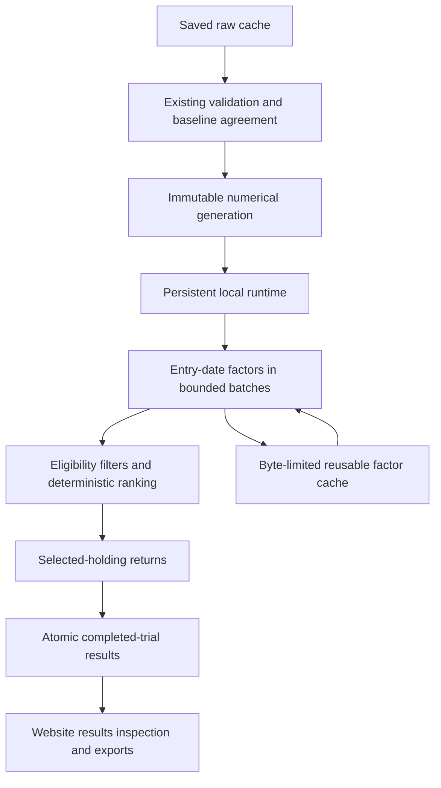

# Master plan for a faster stock backtest engine

Created: 23 October 2026.

Implementation workflow and comparative research updated: 24 October 2026.

Wave5 measurement expansion: 25 October 2026.

Program direction revised after the full matrix and program review: 25 October 2026.

Application integration boundaries updated after reviewed-main integration: 27 October 2026.

Status: CB-00 and CB-01 are complete. **CB-02 is complete by the user's
method-selection decision on 26 October 2026. Numba is accepted.** Further
comparative benchmarking is waived. CB-03 is skipped. CB-04 delivers offline numerical artifacts; see its
[phase record](phases/CB-04.md). CB-05 is complete. Synthetic checks and new private FMP real-symbol
checks pass on WSL and native Windows; see the [CB-05 record](phases/CB-05.md).
CB-06 delivers the entry-date factor interface; see its [record](phases/CB-06.md).
CB-07 is complete with SQL deliberately retained. CB-08 delivers the shared
week/month calendar and monthly compatibility adapters. CB-09 adds one shared
complete financial-result reducer and an offline numerical diagnostic; see its
[record](phases/CB-09.md) for verification and audit status. CB-10 completes
generation-bound offline random recovery and verifies durable snapshot
independence; see its [record](phases/CB-10.md). CB-11 delivers the explicit
persistent bounded runtime; its [record](phases/CB-11.md) tracks verified
behavior and the completed independent audits. SQL and complete-book evaluation
remain in use. CB-12 adds isolated closed preparation and startup verification.
Weekly website controls and numerical calculation routing remain later work.
No production engine or running server routing changes here.

The cumulative design follow-up after CB-12 separates optional compiled guard
translation from base policy construction. Generation preparation, entry factors
and accepted source-guard execution do not require that translator. Explicit
compiled-guard execution binds its own generated-program identity. Conservative
source freshness and numerical-expression validation remain required. The changed
policy identity requires a fresh offline numerical export. See the
[policy contract](../../numerical-generations.md). CB-13A now consolidates
ordinary calculation admission behind one server-owned boundary. Persistent
preview dispatch remains CB-13B; browser/weekly completion remains CB-13C.

The [method-selection decision](phases/CB-02/method-selection.md) is the current
authority. It supersedes earlier instructions to finish the measurement owner,
qualify benchmark-only resources, run another pilot or enforce a 4×/10× release
gate. Earlier measurements, failures and unsupported capabilities remain
historical evidence. They are not recast as passing qualification.

## Current application integration boundary — 27 October 2026

The user accepts the two recommendations from the independent plan review.
The [integration checkpoint](integration-checkpoint.md), commit `71e2548`, merges
reviewed main `b64130a` into the engine branch. Its synthetic WSL/native and
private WSL browser checks establish compatibility on the existing engine path.
They do not qualify candidate routing, real-data capacity or the installed runtime.
At that plan update, CB-05 remained incomplete. The later real-symbol
continuation completes CB-05 only. No later phase is completed by that update.

Current source already owns manual background jobs, the overnight queue and
complete saved-result snapshots. Candidate execution must fit those boundaries:

| Boundary | Responsibility and retained contract |
|---|---|
| Application calculation | `website/backtest_jobs.py:calculate` is the shared entry for background jobs and queued fixed/random tests. The candidate runtime supplies calculation behind it. Existing schedule/NDJSON routes remain compatibility adapters to the same engine capability. |
| Job lifetime | Browser navigation does not cancel server-owned jobs. Explicit Stop and server shutdown request cooperative cleanup. Temporary manual-job results retain their existing expiry and restart behavior. |
| Durable queue | `website/backtest_queue.py` owns admission, ordering, seed/date plans, held edits and retry receipts. Shutdown requeues interrupted work; explicit Stop stays cancelled. Native worker scheduling stays inside the numerical runtime. |
| Durable user evidence | `data/saved-backtests.sqlite` and `data/backtest-queue.sqlite` preserve completed snapshots independently of current input freshness. `website/result-artifacts.js` supplies fresh and reopened views, original labels and downloads without recalculation. |
| Reusable calculation state | Generation-bound checkpoints, prepared books and factor caches can be reused only with matching identities. Their invalidation and bounded retention must not remove durable user evidence. |

Use `backtest_control` and the existing financial coordinator. Legacy request
cancellation observes disconnects. Background jobs survive disconnection.
Queue retries retain their recorded plan and edit identity. Every caller keeps
worker, database and mapping cleanup inside financial and source ownership.
The runtime closes borrowed evaluators before their input attachments.

CB-09/CB-10 define complete evaluator results and generation-bound recovery.
CB-11/CB-12 own the candidate runtime and its startup/closure inside current
application lifetimes. CB-13 connects that capability through the existing
adapter and immutable browser artifacts. CB-14/CB-15 qualify compatibility and
rollback across manual jobs, queued tests and durable saved results.
Do not add another job service or user-result store to implement these phases.

This is a plan-only adjustment to existing boundaries. No code-structure design
is needed. The architecture guide already describes these current-source owners
and the unchanged engine route. No guide content or checked-date update is needed.
The independent commit audit is recorded in
[the plan-update audit](main-integration-plan.audit.md). No new financial or
performance run is claimed. The historical phase and measurement records retain
their original scope and results.

The wave summaries below preserve the earlier sequence and its original gates.

The second CB-02 pilot tested indexed report selection and unused threshold
omission. It matched all 24 trials exactly but took 58.13 seconds, versus
99.72/179.84-second controls. The descriptive conservative ratio is 1.72×.
The retained freshness check took 44.10 seconds. No 5× gate passed. See the
[second-wave record](phases/CB-02/wave2/README.md) for the control drift and
the next validation/report-factor decision. Later production phases stay gated.

The [six-method candidate/factor comparison](phases/CB-02/wave3/README.md) is
complete. Numba and Rust took 17.55 and 17.65 seconds. Persistent workers, bulk
Python, Polars and DuckDB took 21.58, 25.94, 29.06 and 101.81 seconds. All
financial and intermediate comparisons matched exactly. The best conservative
paired ratio was 3.34×; no 5× gate passed. Full freshness consumed about 60% of
the two fastest requests. All named alternatives have now been attempted.
The next bounded experiment must address shared validation/work costs before
expanding unchanged candidates. No production backend is selected.

The [fourth-wave pilot](phases/CB-02/wave4/README.md) retains immediate
request-time manual-edit detection through an equivalent fresh inventory scan.
It adds prepared attachment provenance and policy-derived request planning.
Numba took 12.33 seconds and Rust 13.41 seconds. Faster-adjacent-control ratios
were 10.49× and 9.58×, with exact agreement. Setup took about 146 seconds
separately. This one original-pool F0 seed-42 case is promising, not full
qualification. The [fifth wave](phases/CB-02/wave5/README.md) completed all 17
remaining cases with unchanged measured code. The full matrix has exact
financial agreement. Five of six median gates pass for each method. Broader-pool
F2 fails: Numba 4.66× and Rust 4.53×. No primary cases remain. No production
backend is selected. Shared request costs need another bounded experiment before
integration. Operational qualification and the freshness policy remain unchanged.

The [sixth-wave bounded pilot](phases/CB-02/wave6/README.md) tested only
requested-metric SQL staging in Numba on frozen `cached-F2-20261022`.
Complete staging took 54.17 seconds; projection took 52.04 seconds.
The observed 3.92% reduction and 4.87× conservative production ratio
fail its prospectively declared 10% / 5× criteria. All financial comparisons
remain exact. The intervention stops without expansion. The next bounded
question concerns source-derived candidate guards and assembly. No full matrix
or production integration follows this failed pilot.

The [seventh-wave bounded attempt](phases/CB-02/wave7/README.md) implemented
source-derived candidate decisions and a common encoder. It passed 93 WSL tests
and 92 native tests with one optional skip. The native pair stopped at its
2,700-second whole-experiment bound during the compiled variant's first
production control. The compiled candidate never started. Source guards took
120.20 seconds, with exact evidence, against 691.08/598.52-second controls.
Prepared production inputs match wave6. The timing drift has no established
cause. There is no paired speed conclusion and no expansion. Revise measurement
orchestration or resource planning from those costs before a new bounded pilot.
The guard/assembly hypothesis and all qualification gates remain unresolved.

The decisions below supersede earlier instructions to expand both candidates
or continue the broad method search. Historical phase records retain their
original conclusions and measurements.

## User decision: accept Numba and stop comparative benchmarking — 26 October 2026

The user says: “let's skip the comparsion, and accept using this method.” The
accepted method is Numba. The user accepts the observed performance. Close
CB-02's method selection by this decision. Skip CB-03 and further method search.
The numerical implementation and shared financial policy remain the starting
point. Do not require the unmeasured compiled-guard extension; use the tested
Numba calculation path with the source-owned guards and shared SQL selection.

Remove the prospective source/compiled guard pilot, new current-source primary
speed matrix, integrated speed-matrix repeat, 4× minimum, 10× target as an
acceptance condition, and optimization loops whose sole purpose is passing
those thresholds. Keep reported timings tied to their original source/settings.
There is no new timing result or current-source speed guarantee.

Stop the benchmark-only complete-environment/resource/admission project. Its
separate-host, hard resident/thread/I/O/total-CPU and strict experiment-cleanup
proofs no longer block method selection or production design. The historical
benchmark tools remain closed to real execution. No admission flag or code
bypass is introduced. Existing synthetic evidence and bounds remain unchanged.

Keep financial agreement, `1e-12` tolerances, freshness, canonical report rules,
input provenance, production resource ownership, bounded normal operation,
cancellation, saved-result recovery, Windows startup/offline/browser checks,
weekly scope, stable website protection and rollback. Keep the complete trailing
filter, mixed-filter and empty-coverage correctness cases. Standalone usability
and capacity observations remain useful without paired controls or a relative
speed gate. This decision grants no deployment or protected-asset access.

There are six retired comparison workstreams in the decision record. Two are
18-case matrices: 36 case-level comparisons in total, plus the pending pilot.
This is a procedure count, not an elapsed-time estimate. CB-04 through CB-15
still describe 12 numbered implementation/qualification phases; CB-07 remains
conditional. Reuse demonstrated work rather than treating each ID as a new build.

The private native test workspace is `D:\cb02-private-hh4g0kt5`. It contains a
hash-verified export of committed source. Its 16 native browser/lifecycle checks
pass. That is path/lifecycle evidence only. Source edits and commits stay in
this WSL worktree. Real data has not been copied there. Original/runtime assets
and the preserved real capture remain protected under the existing nonaccess
rules. Later production-input work must resolve its authorized data source.

At method selection, the next ready task was CB-04 design for the production numerical generation
lifecycle, using private synthetic inputs first. Retain the reference for
correctness checks. Do not start another comparative benchmark or fabricate a
passed speed/resource gate. This prose-only selection decision does not need a
code-structure design report. It follows the independent smart-commit workflow.

## User-authorized performance acceptance update — 26 October 2026

Historical decision, superseded by the later method-selection decision above.

The user now accepts **at least 4× median end-to-end speedup** instead of 5×.
This changes the minimum in each of the six primary pool/profile cases across
three seeds. The **10× target** remains. Apply the 4× minimum to future pilot
production-speed criteria, CB-02 integration eligibility, CB-14 qualification
and program completion. A pilot's separate 10% paired-improvement criterion
remains unchanged. No correctness, coverage, freshness, resource, isolation,
workflow-budget or operational requirement changes.

This decision supersedes older 5× requirements in phase briefs and execution
resume records. Historical wave results and independent reports keep their
original criteria and verdicts. Wave5's recorded cached-F2 medians, 4.66× for
Numba and 4.53× for Rust, exceed the new minimum on that historical identity.
This is a comparison with retained measurements, not a new run or current-source
qualification. It does not complete CB-02, open real admission or authorize
production integration. Requalify a changed implementation on one bound identity.

The user requests a new Codex session in this worktree to continue CB-02 until
it is finished. Coherent checkpoint commits inside that session are permitted.
This supersedes the earlier stop-at-next-commit instruction for that session.
Read the [session handover](phases/CB-02/execution/session-handover.md) for the
current boundary and separate-environment authorization. No code changes belong
to this acceptance update, so the code-structure design skill does not apply.

## User-authorized offline capture adjustment (wave11)

After wave10, the user stopped the server and stated: “i already stop the server
running if that simplify the process”. This allows a bounded offline database
copy while the site stays stopped. Continuous live availability is no longer a
capture requirement for this offline window. No server is stopped or restarted
by the capture tool. The general live-service contract still governs later
experiments. No benchmark execution or performance run is authorized.

Wave11 adds a separate offline capture owner. It takes exclusive source ownership
before financial ownership, both without waiting. These locks exclude project
servers and coordinated data jobs throughout SQLite backup and final verification.
Attempts to start the server during capture can wait behind this ownership.
The tool rejects pending journals, sidecars and WAL source headers. It never
prepares, repairs or changes originals. The wave10 synthetic store limits and
closed benchmark admission remain unchanged. See
[wave11 design](phases/CB-02/wave11/design.md).

Prospective limits: one process/thread, 8 MiB SQLite caches, 4 GiB total source
DBs, 8 GiB output, sampled 512 MiB current process memory and 900 seconds for the
whole operation. Cooperative progress/cancellation checks and an external native
watchdog bound the copy attempt. Fixture proofs and independent Code review must
pass before the real copy. This is offline-copy qualification only, not a live
handoff producer, engine attachment or benchmark-resource qualification.

Wave11 completed the stopped-runtime copy after 12 capture fixtures passed on
each platform and independent Code review cleared it. All four closed-admission
tests also pass on each platform. The separate native copy preserves the research,
daily and report set, including saved books. Original content hashes/timestamps
remain unchanged. Independent comparison finds only SQLite header counter/cookie
bytes differ in the database copies; all other bytes match. The one-time monitor
missed EOF after worker exit and required verified controller-only cleanup under
the bound. Its worker exit code is unobserved; valid artifact/invariance evidence
is independently verified. See [wave11](phases/CB-02/wave11/README.md).

This supplies offline test assets, not an execution owner or benchmark admission.
Next bind the copied generation and source/raw freshness to both engines, then
qualify execution resources and concurrent availability. A live capture producer
is required only if future refresh must occur while the website is running.

## Captured input attachment split (wave12)

The wave12 CODE probe finds that connection defaults, report globals and spawned
worker imports still resolve original runtime dependencies. PreparedGeneration
requires a current raw inventory under caller ownership. The offline capture has
no raw tree. Its receipts cannot replace immediate request-time freshness.

Complete one deep captured-input abstraction first: CapturedWorkspace validates
wave11 artifacts and financial coherence, snapshots actual matching source bytes,
and owns read-only inputs and private writable derivatives. Extract shared pure
artifact inspection without changing wave10 behavior or limits. No financial
engine import, runner cutover, current-freshness claim or real derivative creation
belongs to this step. Use only bounded disposable WSL/native fixtures. See
[wave12](phases/CB-02/wave12/README.md) and its raw CODE design.

Next build an isolated engine facade consuming that owner. It must bind both
engines and actual PolicyProgram to the same generation. A qualified request
freshness provider must preserve immediate edit detection and live priority
without holding the live coordinator through calculation. Descendant/resource,
cancellation and concurrent-availability qualification follow. Benchmark admission
stays closed throughout this input prerequisite. No additional real copy is needed.

## Isolated policy attachment split (wave13)

The independent CODE design finds that complete application imports change the
process-global logger. Private module dictionaries do not contain that effect.
Wave13 therefore completes source-only policy attachment in an owned child.
CapturedPolicy consumes the active CapturedWorkspace and constructs an actual
PolicyProgram from its verified private source. It exposes immutable binding
evidence only. It accepts no calculation command. See
[wave13 design](phases/CB-02/wave13/design.md).

Extract the existing policy program into a benchmark-only module with lazy
NumPy imports. Preserve its public alias, financial expressions and signatures.
Keep all existing workspace limits. Source-only child fixtures have a separate
128 MiB sampled memory cap and ten-second attachment deadline. Own child tools
and protocol evidence beneath the workspace. Close the child before workspace
ownership ends, including escaped policy scopes and the recorded EOF/poll race.

The full isolated engine facade remains unfinished. Next bind actual reference
controls and NumericInputs to the same captured financial generation. Then add
current request-time inventory under source-before-cache ownership with live
priority, followed by compiler/mapping/descendant/resource/cancellation and
concurrent-availability qualification. No original metadata is rewritten.
No real capture, derivative, request, pilot or runner cutover is admitted.

## Historical execution decision after the program review (comparison route retired)

The user authorized the three program-review recommendations and confirmed
that Numba remains the working direction. Keep the tested Numba numerical
engine. The wave7 compiled guard/assembly extension is a separate, unmeasured
real-data hypothesis. Neither is a qualified production replacement.

This section and the revised phase map supersede earlier next-step instructions
to deliver separate attachment prerequisites or rebuild each numerical layer.
Historical CB-00, CB-01 and CB-02 wave1–13 records remain unchanged.

### One measured-execution capability

The common operation owns a comparison against one captured generation and
verified source set. It contains reference controls, Numba inputs, private
derivatives, compiler files, observations, results, descendants and shutdown.
Callers do not coordinate these resources or supply original-runtime overrides.

`tools/bench_execution.py:MeasurementExecution` and its private financial worker
implement this operation for disposable fixtures. They reuse actual financial
source, NumericInputs, Numba, SQL selection, portfolio aggregation and replay.
`tools/bench_comparison.py` freezes costs/order and records a terminal comparison
ledger. There is no real-data command or admission switch. The historical
live-cache-locking runners stay closed. Fixture execution is not a speed gate.

The operation has these internal qualification checkpoints. They are not
separate future waves with repeated system handoffs:

1. Verify captured artifacts and actual source together. Reuse the offline copy;
   another real capture is unnecessary. A live-copy producer remains optional.
2. Bind reference controls and both Numba guard variants to those same inputs.
   Default database arguments and spawned imports must resolve private assets.
   Compare complete books, holdings, summaries and committed replay.
3. Obtain a new current-inventory observation inside each timed request.
   The current provider implements source-before-cache observation with a
   source-bound cooperative live-intent contract. Disposable cross-process
   fixtures qualify yielding, not zero-delay access or installed-runtime
   compatibility. Nonparticipating source is rejected. Historical receipts
   cannot supply freshness. Real provider admission remains unavailable.
4. Own resources through confirmed descendant, reader, database and mapping
   closure. Retain ownership on closure failure. Cover cancellation during
   setup, requests and publication. EOF and leader exit are separate evidence.
5. Qualify the real resource envelope and stable-service availability before
   admission. Check the page, panel, fresh/random and cached backtests, saved
   inspection, exports and restart during preparation, execution and failure.

The next [synthetic availability checkpoint](phases/CB-02/execution/availability.md)
uses actual copied HTTP handlers on a private loopback service. It checks five
random trials, cached reuse, explicit-date inspection, complete delivery,
cooperative observation handoff, partial-stream recovery and orderly restart in
a fresh interpreter. Its 16-company fixture has 20,880 price rows. Source
ownership lasts through request-thread closure. Private prepared-storage bindings
do not qualify production preparation or service freshness. Browser rendering,
browser CSV, real-data capacity, installed compatibility and full resources remain
open. This adds availability evidence within the same operation; it grants no
real access or admission.

The old CapturedWorkspace still has its 32 MiB, 128 MiB sampled-memory and
ten-second fixture limits. The measurement owner declares a separate envelope;
its existence does not qualify larger inputs. The roughly three-gigabyte real
capture stays unavailable for execution. Before that use, freeze capture/output
bytes, whole lifetime, process/thread counts, CPU allocation, total experimental
private memory/mapped residency and cancellation/cleanup bounds. The existing
4 GiB default-job working-set target remains a target. Sampled child memory,
environment thread settings and process containment are not complete resource
enforcement or a concurrent-availability proof. The same owner now applies
native Job Object committed-memory, process-count and CPU-rate limits before GO.
Transport frames, bytes and queued events are bounded. Native resident memory,
threads and disk quotas remain unsupported. The newer supervised route contains
the application controller too. A private WSL user-service cgroup bounds charged
memory, combined tasks and CPU allocation. It contains known-source detached
children. Total mapped residency, disk/I/O, cumulative CPU time and the small
outside supervisor remain incompletely bounded. The direct fixture context
still has only Linux session containment. These gaps keep the complete resource
gate open. See the [resource checkpoint](phases/CB-02/execution/resources.md)
and the historical [hardening record](phases/CB-02/execution/hardening.md).

The [native user CPU checkpoint](phases/CB-02/execution/user-cpu.md) adds a
cumulative user-mode termination threshold to the existing outer application
job. Final accounting includes nested and exited descendants. Exhaustion found
at closure rejects a queued successful result. Windows checks periodically;
small fixtures show substantial overshoot. This does not establish an exact
CPU ceiling, total user-plus-kernel enforcement, WSL cumulative enforcement or
outside-supervisor limits. Complete resources and real admission remain open.

### One feasible comparison protocol

Freeze one uninterrupted bracket before execution:

`production control → Numba/source guards → Numba/compiled guards → production control`

Alternate the two candidate positions across seeds. Both candidates may share
the contemporary controls and complete reference evidence only when the
generation, workload, policy/source identity, environment and declared drift
and bracket-age limits match. Each timed request starts without saved-book or
factor-result reuse. Setup remains separate. Freshness, calculation, selection,
saving, encoding and transport remain inside request time.

Declare allocations for attachment, all cloning, all setup, intermediate proofs,
all four requests, evidence collection, shutdown and finalization. Their sum must
fit the whole budget before effects. Each violation stops subsequent steps.
An interrupted attempt retains correctness and committed-trial evidence; a new
attempt cannot append timings to turn that evidence into an accepted pair.

Wave7's four-control protocol was not cost-feasible at its observed durations:
four controls at 598.52 seconds consume 2,394.08 of 2,700 seconds. Only 305.92
seconds remain for all other work. Its source setup alone took 148.33 seconds,
and its source request took 120.20 seconds. Two shared controls reduce repeated
work, but do not establish a sufficient budget for the unmeasured treatment.
These are calculations from historical costs, not new timings or an explanation
of drift. The source-only [prospective declaration](phases/CB-02/execution/prospective-comparison.json)
now allocates 6,960 seconds within a 7,200-second whole bound. It declares each
step, a 1.20 maximum control ratio and a 6,600-second bracket. These are stop
allocations, not cost predictions or user budgets. Real binding, resource and
availability prerequisites are pending. Validation cannot grant admission.

After a promising qualified pair, run the unchanged six-case, three-seed primary
gate on one implementation identity. Repeat it on the integrated engine. Keep the
historical cached-F2 failure against 5× visible. Keep all incomplete trials
visible and the complete trailing-filter supplement separately frozen. Only the user-authorized minimum changes to 4×; all other requirements remain.

### Capability-based sequence

Two program decompositions were considered. The earlier horizontal sequence
implemented primitives, metrics, selection, portfolios and runtime in order.
That split now repeats demonstrated work and puts measurement lifetime too late.
Use three deeper contracts instead: the measured evaluator, immutable generation
lifecycle and service lifecycle. The phase IDs below name evidence and hardening
responsibilities; they do not require separate implementations of known layers.

Set prospective user workflow budgets before finalizing runtime and cache
decisions. Installation, restart, fresh dates, changed filters, reopening and
weekly research remain unresolved acceptance decisions. Benchmark stage limits
cannot substitute for user budgets. Freeze the weekly calendar contract early
enough to inform batching and capacity. Weekly support remains required for
program completion. Do not add weekly controls before its correctness gate.

## Objective

Implement the user-accepted Numba path for random-date stock-screen research. Preserve financial results and normal operation. The user accepts the observed performance; a new old-versus-new timing comparison or relative speed threshold is no longer required.

The main workload is at least 24 random-date trials over **1997–2025**, usually with **12-month** rebalancing. The user changes filter settings between experiments. The intended interval range is **one week through two years**. Support fresh random dates and explicit-seed replay. Keep observations descriptive; do not invent a current-source speed claim.

Preserve holdings, ranks, valuations, returns, coverage, exit treatment and random-date experiment meaning. Keep the website, data panel, local launcher and offline research workflow usable. A complete engine replacement is permitted when evidence supports it.

This is a program-level plan. Each phase is scoped for one Codex 6.1-sol session. Each code phase must use `$strategic-design-plan` for its detailed code structure, then implement and verify the change, then use `$smart-commit`. The phase agent carries this sequence through automatically. It asks the user only for a critical blocker or a decision that cannot be resolved within the authorized scope. This document does not prescribe every module or function.

The [research findings and primary sources](research.md) explain the options and their limits. They are part of this plan.

### Keep the current website usable until full replacement readiness

User requirement added on 25 October 2026: the user must keep using the current
website and its slower backtest engine throughout development. This applies to
every remaining phase, including benchmarks. A successful pilot or primary speed
gate does not authorize replacement of the live website.

The installed Windows engine is the stable service. Source edits, experimental
commits and candidate failures must not stop or replace it. Keep its normal
screens, fixed-date and random backtests, saved results, inspection, CSV exports
and data panel usable. Preserve its raw cache, prepared databases, saved books,
settings and working Python environment. Normal user-requested starts and stops
remain supported.

The installed deployment revision observed on 25 October is
`63dda8fda1e3b1e76ef75c10453246f9e74c2a07`. Its main page, data panel and one
cached 50-stock backtest were checked. This identifies the current fallback;
it is not qualification evidence for the new engine. Record and verify the
actual stable revision before later work rather than assuming it stays fixed.

**Required safeguards before further experiments or integration:**

- Keep candidate code, dependencies, generated data, compiler caches and result
  stores separate from the installed service. A different port or temporary
  output directory alone does not prove isolation.
- Prepare a consistent, generation-bound input snapshot for both benchmark
  engines. Do not keep the live cache lock for preparation, calculation or
  cleanup that would block a user backtest. Use a qualified bounded handoff;
  defer work that cannot safely obtain one. Preserve all existing coordination,
  lock-order, publication-journal and freshness rules. Do not bypass a shared
  resource lock or create a second full raw cache in WSL.
- The live website has priority over experimental CPU, memory and disk use.
  Declare resource limits and verify isolation before a long job. If user work
  conflicts, defer or stop only the owned experiment. Keep interruption evidence;
  do not count affected timings as passing speed evidence. Never stop the user
  server or make user requests wait behind an experiment to obtain cleaner times.
- Keep the stable deployment revision and restart path protected. Wave8 changes
  normal WSL publication to retain the installed commit, or the pending commit
  during recovery. The installed launcher delegates to that WSL tool. Explicit
  revision selection remains a deliberate operator override. Isolated fixture
  tests qualify request-start selection, not a live restart or replacement
  engine. Never publish unqualified source over the installed service. Preserve authenticated server ownership and deployment recovery.
- Early opt-in previews may use a separate instance and URL. They must have
  isolated data ownership and leave the stable default available. Do not migrate
  the stable cache in place or require the user to use a preview.

**Availability gate:** Prove that the stable main page, data panel and a cached
backtest still work while the candidate prepares, runs, cancels and fails. Check
that stable restart still selects the known-good engine. Verify fresh-date and
random backtests, saved-result inspection and exports on production-equivalent
isolated fixtures. Check for cache-lock errors, resource contention, changed
source and incompatible cache writes. A failed isolation or availability check
blocks the experiment or deployment; continue only work that leaves the live
service usable.

**Full readiness gate:** Keep the stable engine as default until CB-14 passes
all financial and coverage checks, the complete
trailing-filter supplement, all promised month/week intervals and capacity
checks, agreed workflow budgets, Native Windows startup/offline/lifecycle checks,
and saved-data compatibility and rollback checks. Unresolved budgets or checks
block cutover. CB-15 can then switch the default and verify the live workflow.
Keep the known-good engine and compatible old caches through the documented
rollback period. Candidate failure must leave the stable service usable.

Before CB-15, integration work in this plan means work in the isolated candidate
preview. The accepted method permits isolated hardening and integration. Publication over
the stable installed website still requires readiness and CB-15 verification.

These are required safeguards, not implemented isolation claims. Wave8 implements
the request-start publication revision safeguard and verifies it on isolated
fixtures. Wave9 adds a closed execution-admission policy in benchmark tools. It
admits no runtime. Source-only imports remain available for synthetic fixtures.
No live restart or deployment qualifies the later gates. Wave7 used
isolated result files but held the production cache coordinator. That approach
must not be repeated while protecting live use. That earlier CB-02 design had to solve website-safe measurement before another
real-cache pilot. The user has now retired comparative measurement. This
availability-contract update did not implement or start that work. The wave8
revision prerequisite remains separate from bound-input ownership and resource isolation.

### Adjust the plan when new evidence changes the direction

This is a living plan. Implementation experience, benchmark results and user
workflow findings can justify changes to priorities, phase scope, sequence,
dependencies and the chosen method. Update this master plan when those findings
change the remaining work. Do not keep an obsolete phase sequence merely because
it was written first. The 25 October revision is an example of this process.

Record the evidence, the decision, affected phases and checks, and the next
unresolved question. Preserve earlier measurement records. Distinguish a proposed
change from implemented or qualified behavior. Recheck dependent phase briefs,
the status ledger, research guidance and affected user documentation together.

Make routine adjustments within the authorized objective autonomously. Ask for
a user decision before changing the investment rules, correctness tolerance,
performance acceptance criteria, promised interval scope or freshness guarantee.
A failed gate is evidence for changing the work, not evidence that the gate passed.

## Decisions and open gates

| Subject | Program direction | Evidence still required |
|---|---|---|
| Calculation model | Numba accepted; use tested calculations, source-owned guards and shared SQL/aggregation. Compiled guards are optional deferred work. | Production correctness, freshness, bounded normal operation and application readiness. No comparative pair or speed gate. |
| Data model | Immutable numeric inputs, sparse price histories, bounded entry-date factor batches. | Sparse versus dense access, measured memory and Windows mapping lifecycle. |
| Method choice | Numba selected by user. Retain other methods as historical evidence. | No further alternative comparison scheduled; revisit only if the user changes direction after a concrete blocker. |
| Policy ownership | All six candidate executors use source-derived financial expressions. Guard policy remains source-owned, including the optional compiled Numba decisions. SQL selection and portfolio assembly remain common. | Exact intermediate, holding and replay agreement. |
| Database role | Keep verified research data, SQL selection and compact trial storage. Replace candidate staging or selection only for a measured limitation. | Generic native selection and selected-only return evaluation are not demonstrated; any replacement needs exact parity and measured benefit. |
| Analytical alternatives | DuckDB and Polars remain historical evidence. | No alternative comparison is required for this program. |
| Deployment | Preserve the stable installed website and restart revision until full replacement readiness; qualify candidates separately. | Website-safe isolation, protected publication, shutdown, generation replacement and memory tests on native Windows. |
| Weekly intervals | CB-08 defines calendar configuration version 1: 1–104 weeks or 1–24 months. A week is seven calendar days. Existing month requests map in memory. | Calendar implementation and compatibility evidence are in CB-08. Weekly evaluator, capacity and website checks remain before controls. |
| Freshness | Retain immediate request-time detection under the existing path/size/mtime rule. | Equivalent scan evidence and stale-generation checks; no startup-only substitution. |
| User experience | Set absolute time budgets for installation, restart, fresh research, changed filters, reopening and weekly research before final runtime/cache decisions. | User-agreed prospective budgets and native measurements; annual relative speed alone is insufficient. |

The [24 October comparative research](method-research-2026-10-24.md) led to
attempts of all six named methods in the [third wave](phases/CB-02/wave3/README.md).
The historical Numba/Rust matrix supported the earlier focus on Numba.
Numba has the lower median request duration in all six cases. The differences
are small; neither method passed the then-required 5× speed gate. Their historical
medians exceed the earlier 4× minimum on their old identity. The user has now
accepted Numba without another comparative qualification. Production correctness
and operational readiness remain required. This is no new timing result or
claim of general superiority.

Use one accepted Numba method. Do not develop Rust alongside it or start
another comparison by default. Keep one shared financial policy. Retain the
reference for correctness. Experimental dependencies remain isolated.

## Scope and boundaries

### Required outcomes

- Faster fixed-date and random-date calculations through one financial path.
- Both the original `legacy` pool and the broader `cached` pool.
- All current ranking metrics, threshold filters, rank ranges and metadata filters.
- Fresh dates, repeated filters, saved-result replay and completed-trial recovery.
- Explicit weekly and intermediate week/month intervals through two years.
- Correct selected-stock inspection, CSV downloads, progress and error behavior.
- Automatic preparation and dependency handling through the existing launcher.
- Native Windows qualification. Linux/WSL correctness remains required, but its timings are not the Windows baseline.

### Scope held outside this program

Do not change the investment strategy, annual availability assumption, universe coverage, bankruptcy classification or canonical report cutoff to obtain speed. Do not refetch available market data. Do not add brokerage execution, intraday simulation, transaction costs, cloud services or distributed computing.

January and latest website modes can keep their prepared database and standalone browser path. Replacing those paths is not a prerequisite for accelerating dated schedules. Their calculations and exports must continue to agree with the common policy and catalog.

Keep `scripts/revalue.py:calculate` independent. Do not make the reference call the replacement numerical engine. Keep canonical report/database publication under `scripts/baseline.py`.

## Candidate behavior and data flow

The following architecture is provisional. CB-02 may revise the input format,
calculation boundary and later phase interfaces before production design.

Preparation validates saved inputs and produces one immutable numerical generation. The local runtime attaches that generation. A job calculates the required entry-date inputs, applies filters and ranks stocks. It then calculates returns for the selected holdings and publishes completed trial evidence.

### Units of reuse

| Data or result | Identity | Lifetime |
|---|---|---|
| Base numerical inputs | Verified source and report generation, format version and policy dependencies | Until a new generation is published |
| Report-level inputs | Symbol, selected report, applicable history and policy version | Within that input generation |
| Entry-date factors | Generation, entry date, pool and available factor fields | Bounded memory cache; optional disk persistence only if measured |
| Selected portfolio result | Generation, exact entry/exit dates and complete selection configuration | Reusable completed result |
| Random experiment | Generation, policy version, exact sampled dates, settings and trial count | Durable completed-trial checkpoints |

Entry-date factors must not depend on a future exit. However, the current code has period-specific eligibility checks, including the actual entry date being before the exit. Apply these checks before ranking. Deferring return arithmetic must not defer eligibility until after selection.

Avoid a complete daily factor cube at startup and avoid a table of every possible entry/exit return. See the memory estimates in the research findings.

## Financial correctness contract

Treat the current source as the executable reference. Root `AGENTS.md` remains binding. Resolve discrepancies between old prose and code explicitly; do not quietly change results.

| Area | Required behavior |
|---|---|
| Reports | Fiscal year-end plus 90 days; strict `known < entry`; drop reports older than 800 days. Preserve eligible USD fields and conflict handling. |
| Original pool | Apply reported-size eligibility before selecting its annual report. Preserve the original single-year 250-candidate pre-price buffer and its stable tie order. |
| Broader pool | Use cached-price coverage. Do not label it the full historical universe or imply a complete manual early-stop review. |
| Valuation | Keep the existing selected valuation series and its fiscal/entry price tolerances. Preserve formula operation order and current rounding behavior. |
| Entry | Preserve forward valuation-price and adjusted-price searches, missing-price exclusion and actual entry-date checks. |
| Exit | Preserve the normal 10-day backward search, long last-price fallback, dates, status labels and `(entry year, symbol)` bankruptcy override. |
| Thresholds | Strict `lt` and `gt`; all conditions pass; display units; missing values fail only conditions needing them. Preserve signed cash flow and margins. |
| Financial ratios | Selected report only; current denominator rules; four positive EPS years for PEG; mean positive current/prior equity for ROE. |
| Ranking | Metric yield descending, candidate rank ascending with the current SQL null behavior, then symbol ascending. Preserve arbitrary supported rank ranges. |
| Returns | Equal weights use actual selected count. Keep stopped proceeds in cash until the next rebalance. Preserve calculation and aggregation order. |
| Experiments | Same random samples for an explicit seed; common-window cash before the first trade for both strategy and SPY; paired incomplete-trial exclusion. |
| Coverage | Keep short and empty periods visible. No full-period strategy CAGR when a selected period is empty. |

Use float64. Do not weaken `baseline.REL_TOL` or `ABS_TOL`, currently both `1e-12`. Symbols, ranks, dates, statuses, membership and missingness must match exactly. Compare unrounded numeric fields at the existing full-precision tolerance and report maximum differences. Preserve bitwise identity where current formulas already provide it.

Keep financial calculations under one owned policy/catalog path. Consumers must remain generic. A compiled backend is not permission to hand-code a different P/E, PEG or EBITDA formula in each runtime. A bounded extraction of numeric policy functions is permitted when the same functions remain callable by the scalar and compiled paths. The independent January reference must remain independent.

## Interval contract

Website controls and financial-facing requests still support 1, 3, 6, 12 and
24 months. CB-08 adds the separate standard-library calendar owner in
`scripts/schedule_calendar.py`. Its [contract](../../schedule-calendar.md)
defines planning for 1–104 calendar weeks and 1–24 calendar months. It does not
add weekly website controls, result labels or an engine route.

Calendar configuration version 1 has exactly `version`, `start`, `end` and
`interval`. The interval has exactly `unit` and `count`. Units are `week` or
`month`; counts are integers in the stated ranges. This version is independent
of database schemas, numerical artifacts and ResultArtifacts. Legacy
`start`/`end`/`months` requests map in memory to version-1 monthly configurations.
Only the five existing month counts are accepted in that form. Omitted months
means 12; explicit null fails. Mixed, unknown and ambiguous forms fail even when
their values appear equivalent. Existing saved records are not rewritten.

Every target stays anchored to the original requested start. A week is seven
calendar days. Monthly targets clamp the original day at month end without
drifting later targets. The common start rolls forward to a saved SPY session.
The inclusive end mark rolls backward. An end after the last saved session is
rejected. At least two sessions must remain in the window. Fixed targets roll
forward; duplicate rolled entries merge and entries at the final mark are
excluded. 104 weeks and 24 months remain different intervals.

Random blocks use nominal anchored boundaries, with half-open `[left, right)`
bounds. The last block ends at the final mark. Retain a nonempty partial final
block. Skip empty blocks without a draw. Sample one ascending saved-session
population per block using `random.Random(seed).choice`, in trial-major then
block-major order. Existing monthly samples remain exact. Explicit-date
validation resolves the common window directly and has no interval dependency.
The existing evaluator and its monthly result metadata remain unchanged.

Calendar correctness is separate from weekly financial-result compatibility,
capacity and website qualification. Those remain in CB-09 through CB-14.
The old random planner did not support weekly trials. Historical benchmark
admission remains closed.

## Historical comparison specification; operational checks retained

### Primary comparison (retired by the method-selection decision)

Use native Windows on the user's machine. Use 24 trials, 1997-01-01 through 2025-12-31, and a 12-month interval. If the saved SPY cache does not cover these endpoints, stop and report that condition rather than silently changing the window.

CB-01 freezes a manifest with explicit sampled date lists, not only seeds. Suggested reproducible seeds are 42, 20261022 and 20261023. Record all request defaults explicitly. Use both pools and three filter profiles:

| Profile | Purpose | Initial fixture settings |
|---|---|---|
| F0 | Ordinary selection | Current EV/EBITDA, ranks 1–50, current default cap/EV limits, no added thresholds |
| F1 | Annual financial filters | F0 plus P/B `< 3` and ROE `> 10` in display units |
| F2 | Trailing-price filters | F0 plus one-year and three-year trailing returns `> 0` |

These thresholds are engineering fixtures, not investment recommendations. Add a mixed-filter, three-year-ranking and top-100 case to qualification. Add a deliberately empty selection to correctness checks. Preserve concrete user strategy settings in supplementary manifests without changing the frozen primary manifest.

Every frozen F2 trial has an empty period and a null full-period CAGR. Keep F2
unchanged as a primary performance and incomplete-coverage test. Add a separate
trailing-filter workload that produces complete trials and usable paired CAGRs
on the declared saved inputs. Establish its coverage before timing, then freeze
its settings and dates. Never replace the failed primary F2 case with this
supplement. Include mixed filters and repeated filter changes in workflow
qualification. Report complete and incomplete trials separately.

The earlier requirement was at least 4× median speedup in each primary case, with a 10× target. The user has now waived these comparative gates. Keep the workload settings available for financial correctness and coverage checks. No new relative speed claim follows.

### Measurement rules for retained historical tools (no new comparison required)

1. Freeze source identities, input generation, report hash, versions, CPU/thread counts and settings.
2. Run against isolated inputs and derived data under ignored Native `tmp/`. Prove live-website and data-ownership isolation first; a separate result directory alone is insufficient. Never clear the user's real books or hold its cache coordinator through a benchmark. Keep both engines bound to identical verified inputs.
3. Give both engines identical base data and date samples. Each timed primary run starts without completed date-pair results or reusable entry-factor results. A loaded immutable base dataset is allowed for both.
4. Include validation performed during the request, selection, return calculations, staging, completed-trial saving, response encoding and local transport. Use the same HTTP harness or equivalent isolated adapter for both engines.
5. Separate first installation, source preparation, compiler-cold startup, restart with a compiled cache, and an already-running request. They are different measurements.
6. Alternate engine order across the three seed runs per case. Use the same power settings and avoid simultaneous benchmark jobs. Do not claim the OS cache was cold unless it was actually controlled.
7. Report fresh-date runs, same-date filter changes and exact-result replay separately. No replay-only speed claim satisfies the objective.
8. Record wall time, stage times, private memory, working set, peak thread/process counts, artifact size and written bytes. Explain any timing exclusions.

The six primary cases require 18 paired runs across the three seeds. Capture one baseline run per case first to check cost. Run the full matrix in resumable batches if needed. Do not silently reduce the protocol when a session ends.

### User workflow budgets

The relative annual speed gate is waived. Normal startup and an interactive
research workflow still need operational checks. Before qualification timing,
record an absolute time budget and a measurement boundary for each workflow:

| Workflow | Required measurement | Budget status |
|---|---|---|
| First installation and first ready result | Dependency installation, preparation, attachment and compilation, with each cost separate | To be resolved before operational qualification |
| Normal restart | Launcher start to ready service, then the first completed result | To be resolved before operational qualification |
| Fresh-date research | Request to completed 24-trial result with no saved-book or factor-result reuse | To be resolved before workflow qualification; no paired speed gate |
| Changed filters | Same dates with new settings; report permitted factor reuse and completion time | To be resolved before workflow qualification |
| Saved-result reopening | Request to visible inspection and export-ready evidence | To be resolved before workflow qualification |
| Weekly research | Short-window pilot, then the declared full-window workload, with resource caps | To be resolved before weekly capacity qualification |

Choose budgets from the intended user workflow. Do not select thresholds merely
to match an observed timing. Proposed acceptance budgets require a user decision;
missing budgets remain unresolved and block the relevant release qualification.
Wave5 attachment/setup took 52.73–152.03 seconds for its new cases. Those are
historical setup observations, not acceptable-latency targets or full launcher
measurements. No first-use or compiled-cache restart speed claim exists yet.

### Capacity and operational checks

Qualify 100 annual trials, the existing month intervals, intermediate intervals, top-100/rank slices and the weekly extension. Use bounded old-engine explicit-date comparisons for new weekly numeric returns. Use independent calendar fixtures for weekly sampling. The old random planner cannot serve as the weekly sampling reference.

A 24-trial full-window weekly workload has roughly 36,000 holding periods. It must use bounded buffers and cancellation checkpoints. A 100-trial weekly workload is a capacity test; it is not necessary to generate an enormous old candidate database to claim annual speedup. Start with a short-window pilot and record an explicit runtime/disk cap before running it.

Target at most **4 GiB peak process working set** for the default 24-trial broader-pool job on the inspected dataset. Track private bytes and mapped residency separately. Bound the factor cache by bytes. Repeated filter runs must not cause unbounded growth. If the target is infeasible, document a measured memory budget before enabling the engine by default.

## Preparation and runtime safety

### Generation publication

Build numerical generations under an ignored local data directory. A generation has an explicit schema, source identity, policy/catalog signature, buffer hashes, dtype/shape information and stable ordering metadata. Export from already validated prepared inputs. Do not create a second raw-data validation policy.

Publish a new directory only after validation completes. Switch a small current-generation pointer atomically under `cache_access`. Keep the previous valid generation through failed or interrupted preparation. Never overwrite mapped buffers in place. Test interrupted writes and Windows access/sharing failures.

Bind to immutable base inputs, not the whole mutable daily database. Capture fingerprints after research preparation because preparation can update the canonical report. Unfinished baseline publication must continue to block readers.

### Freshness

Validate raw inputs fully during preparation and startup. A normal job checks
the compact prepared-generation identity and the current raw inventory under
the existing project coordinator. Downloads and repair operations must mark
prepared inputs stale before releasing ownership, including cancellation after
partial successful publication.

Retain immediate request-time detection of direct edits under the existing
path/size/mtime rule. Wave4 demonstrated a faster equivalent inventory scan;
Wave5 retained it throughout the full matrix. Use the prepared identity together
with equivalent current inventory evidence. Do not replace it with startup-only
validation. A same-size edit with a restored timestamp remains outside the
existing metadata guarantee. Any future proposal to change that guarantee needs
separate evidence and a user decision. Removing scans is not a planned shortcut.

### Resource ownership

Retain lock order: process-local reentrant lock, project file lock, then database
handles, mappings and worker resources. Retain ownership of the resources in use
through native work and final closure. Keep current cross-server serialization
for production jobs sharing the live cache. Experimental jobs must own isolated
resources; they must not hold the live coordinator for the experiment lifetime.
A snapshot handoff must be consistent and qualified before use. If safe isolation
is unavailable, defer the experiment rather than bypassing ownership. Concurrent
experimental and production jobs against the same writable cache are not required.

Use one native parallelism layer with a measured cap. Do not create a new process pool for every trial or a full data copy per worker. Use bounded chunks so progress and cancellation can occur between native calls. Closing the terminal must stop native work before releasing lifetime ownership.

Treat the numerical generation signature and compiled-code signature separately. The compiled signature covers imported policy code, catalog, relevant constants, bankruptcy inputs, runtime/compiler versions and target platform. Numba's own cache invalidation is insufficient by itself; see the research findings.

### Recovery and compatibility

Commit completed trial evidence atomically. Configuration identity includes exact dates, generation, policy version, pool, metric, filters, limits, interval and rank range. Preserve distinct trial identities when schedules happen to repeat. Never reuse a result from another generation.

Keep the old cache and reference calculation path available during rollout. Do not delete existing books to create the new store. Inspection of old saved experiments must either route to the compatible old path or require an explicit recomputation. Do not silently show current data as the old experiment's evidence.

## Phase map

CB-00 is the preparatory WSL/native-Windows workspace migration. Its design and
handoff are filed in `phases/CB-00.design.md` and `phases/CB-00.md`. It does not
implement the compiled calculation engine. Read that handoff before CB-01.

CB-01 measurement is complete. Its [phase record](phases/CB-01/README.md) contains
the frozen workload, all 18 accepted cases and operational limits. CB-02 is
complete by user selection of Numba. Further comparative gates are waived.
CB-03 is skipped. Production correctness and operational qualification remain. CB-04 through CB-15 describe remaining capabilities. Reconcile
these briefs with demonstrated work and the ongoing website availability
contract before implementing them. Phase identifiers
are stable references, not a fixed session count or a demand to rebuild prototypes.
Split or merge remaining work when the evidence warrants it and record the change.

### Delivery milestones and evidence gates

| Milestone | Result and exit evidence | Related phases |
|---|---|---|
| Protect ongoing website use | Verify stable publication/restart and candidate resource/data isolation before work can affect the live website | Cross-cutting prerequisite; next CB-02 design and CB-12–CB-15 |
| Accept the calculation method | Complete by user selection of Numba; further comparison work retired | CB-02 complete; CB-03 skipped |
| Prove operational feasibility | Isolated installation, startup/restart, invalidation, cancellation and recovery proofs; agreed workflow budgets | Early bounded proofs, then CB-04/CB-11/CB-12 hardening |
| Deliver faster existing workflows | Isolated opt-in preview for existing month intervals, filters, trial inspection and exports; preserve the stable website | CB-04–CB-07 and CB-09–CB-13 |
| Add weekly research | Frozen calendar, correct explicit-date returns, useful latency and bounded resources | CB-08 and weekly extensions in CB-09–CB-14 |
| Qualify and enable the default | Financial, coverage, workflow, weekly and operational gates pass | CB-14 and CB-15 |

The website-protection milestone applies throughout the program. The early
performance and operational milestones can expose risks before weekly capacity work. Existing
month workflows can be delivered in an isolated opt-in preview before weekly
controls. The stable installed website remains available. Weekly support
remains required for program completion. Annual speedup does not qualify weekly
latency. Default cutover waits for all promised capabilities and gates.

User selection of Numba permits production design and isolated integration.
Keep financial correctness and operational blockers explicit. Publication over
the stable website waits for the retained CB-14 readiness checks and CB-15
verification. A relative speed matrix is no longer an integration prerequisite.

Before each implementation phase, classify relevant evidence as **demonstrated
and reusable**, **demonstrated but needs production hardening**, or **unknown and
needs an experiment**. Link the proof and its limits. Prepared attachment,
source-derived numerical factors, exact selection and completed-trial replay
already have benchmark evidence. Production publication, launcher lifecycle,
full filter-change performance and weekly capacity still need qualification.
Reuse sound work; implement only the missing capability or hardening.

| Phase | Scoped result | Depends on |
|---|---|---|
| CB-00 | WSL source and native Windows deployment workflow | User's split-workspace request |
| CB-01 | Reproducible current-engine baseline and frozen workloads | CB-00 and this plan |
| CB-02 | Complete by user acceptance of Numba; further comparative work waived | Retained CB-01/CB-02 evidence and method-selection decision |
| CB-03 | Skipped; no further alternative comparison scheduled | Numba selected by user |
| CB-04 | Publish/attach/retire immutable numerical artifacts; reuse tested sparse inputs | Tested evaluator interface and user selection; retain financial and operational checks |
| CB-05 | Harden demonstrated temporal primitives within the evaluator | Existing Numba report/price proofs; CB-04 artifact interface |
| CB-06 | Harden demonstrated source-owned catalog and dependency planning | Existing policy/factor proofs; CB-04 artifact interface; no fresh formula implementation |
| CB-07 | SQL-equivalent generic native selection only where evidence calls for replacement | CB-05/06 contracts; retain shared SQL until parity and benefit pass |
| CB-08 | Freeze week/month contract early; implement and qualify the calendar independently | CB-01; freeze before runtime/cache design; weekly planner does not block month-only fixture measurement |
| CB-09 | Harden common portfolio evaluation; qualify any selected-only return replacement | Existing aggregation proofs; CB-07 only if selection is replaced; CB-08 for new interval planning |
| CB-10 | Harden demonstrated completed-trial storage, replay and compatibility | Measured evaluator/result contract; reuse current exact saving and replay |
| CB-11 | Persistent production runtime and stress; reuse demonstrated lifetime ownership | Production lifecycle after CB-04/10 interfaces; comparative measurement work retired |
| CB-12 | Isolated candidate startup/data panel and stable revision protection | CB-11 |
| CB-13 | Isolated opt-in preview UI/API, inspection and exports; stable default preserved; weekly controls when qualified | CB-12; CB-08 and weekly evaluator checks for new controls |
| CB-14 | Full numerical and operational qualification | CB-13 |
| CB-15 | Default cutover, documentation and retained fallback | CB-14 passed |

### CB-01 Capture the baseline

**Recorded:** Complete on 24 October 2026. See the [phase report](phases/CB-01/README.md),
[frozen workloads](phases/CB-01/workloads.json) and [compact evidence](phases/CB-01/baseline.json).
All primary runs are complete. Every F2 trial retains one empty period and a null
full-period CAGR. Timings vary materially. Later speed claims require the paired
comparison protocol in this plan; archived timing ratios alone do not qualify an engine.

**Outcome:** A later session can reproduce the current behavior and timing without using this conversation as evidence.

**Work:** Freeze sampled dates and primary settings. Capture source hashes, data generation and report hash. Extend the benchmark harness to use isolated derived caches and compare full holding evidence. Measure current request stages, source scanning, worker initialization, calculation, selection, publication and response delivery. Start with one pilot before the full matrix.

**Deliverables:** A tracked workload manifest, a compact baseline report, a benchmark command and a correctness-case inventory. Store bulky outputs and disposable databases in ignored `tmp/`. Record any skipped runs as pending.

**Verification:** Repeated explicit samples return the same selections and values. Production raw files, report/database pair and real completed books stay unchanged. Native Windows execution is recorded. The comparison has no hidden saved-book reuse.

**Handoff:** Exact commands, fixture identities, baseline timing matrix and the identified serial costs. Do not implement the replacement engine in this phase.

### CB-02 Select the method (complete by user decision)

**Current outcome:** Numba accepted. Comparative qualification is waived by
the [method-selection decision](phases/CB-02/method-selection.md). The experiment
sequence below keeps its original evidence and failed/unrun verdicts.

**Outcome:** Evidence for choosing, revising or rejecting an optimization method
before production integration. No backend is selected from library reputation.

**Completed comparison:** Independent method experiments covered sparse
Python arrays, NumPy/Numba batched searches and DuckDB ASOF lookup. The initial
experiments share scalar financial policy, in-memory SQL selection and durable
selected-trial publication. Their results compare price resolution and common
publication changes; they do not compare fully rewritten financial engines.
Keep the original pools and all production code unchanged. Use the CB-01
24-trial dates, both pools and F0/F1/F2. Run a first-seed pilot, then expand
promising methods to all three seeds. Preserve mixed-filter, three-year,
top-100 and weekly-explicit-date checks as additional qualification work.

**Deliverables:** Updated research, one shared experimental contract, disjoint
method modules, complete holding comparisons, native timings, stage and memory
evidence, dependency versions and a decision table. Record pending or failed
methods explicitly. Files stay separate from production paths.

**Verification:** Compare every selected holding, aggregate and supported
intermediate input. Include current full freshness scans, result saving and
local response delivery in headline times. Keep loading and cold compilation
separate. Use contemporary fresh controls and show timing drift. Disable
compiler-cache reuse for the initial Numba lookup experiment; production
invalidation proof remains required before integration. Test interruption and
committed-trial recovery. A pilot remains unqualified.

**Recorded experiment sequence:** The following pilot scopes and decisions are
historical. The next-experiment brief below defines the remaining work.

**Initial pilot result:** The original-pool F0 seed-42 lookup/publication
comparison measured arrays at 52.62 s and Numba lookup at 53.10 s. Contemporary
controls took 78.98 s and 115.31 s. DuckDB per-book ASOF exceeded its declared
180 s request budget with five complete trials. No method qualified. See the
[full pilot record](phases/CB-02/README.md). Do not expand unchanged lookup
adapters until the shared scalar report/factor bottleneck is addressed.
The [report-index follow-up](phases/CB-02/wave2/README.md) completed the same
case in 58.13 s with exact financial agreement. Controls took 99.72/179.84 s.
The faster-control ratio was 1.72×, with 80% control drift. The full freshness
check took 44.10 s. All 1,832 distinct frozen sample dates passed complete
ordered report/rank comparisons; that is not full financial qualification.
Do not expand the unchanged method across the matrix. The next bounded decision
must address validation cost and remaining report/factor work. Any changed
freshness policy needs an explicit accepted contract and verification before
headline comparisons omit the current scan. Whole-batch analytical execution
and persistent bounded execution remain alternatives. These pilots do not
reject complete compiled or SQL financial engines.

**Third-wave scope:** The [third wave](phases/CB-02/wave3/README.md) tested all six
candidate/factor approaches. Each executor owns temporal report selection,
sparse price searches and source-derived numerical arithmetic. Final SQL
selection and financial aggregation remain shared. It starts with Numba, then
bulk Python, DuckDB, persistent workers, Polars and Rust. Current full freshness
stays in primary timing. Each method also gets real intermediate proof and
both-pool financial, trailing and mixed-filter checks. Failure of one method
does not stop the comparison. These tests bring the previously reserved Rust
and Polars alternatives into CB-02; CB-03 needs a further concrete question.

**Six-method result:** All methods completed the original-pool F0 seed-42
primary case and all six real filter requests. Complete candidates, holdings,
summaries and replay matched exactly. Numba and Rust were effectively tied near
17.6 seconds. The other requests took 21.58–101.81 seconds. No 5× gate passed.
The full freshness check took 10.16–10.95 seconds. Attachment cost 40.87–50.56
seconds separately. Do not infer first-use or full-matrix speed from warm pilots.
See the [collected evidence](phases/CB-02/wave3/results.json). Deferred work is
explicit: the other 17 primary cases, capacity and production qualification.
No remaining named method is silently reserved or untested. CB-03 now requires
a further concrete unresolved question.

**Fourth-wave result and split:** The benchmark-only prepared attachment checks
its captured numerical generation, policy-source provenance, current research
metadata and full report binding. It rejects unfinished publication and stale
reuse. Every request still enumerates the same current annual inventory and
compares the current path/size/mtime evidence. Attachments prove exact equality
with the authoritative scanner. This is an equivalent scan implementation,
not the then-proposed CB-12 startup-only manual-edit policy. That proposal is
retired by this revision.

Numba/Rust completed all 88 primary and correctness trials exactly. The frozen
`legacy-F0-42` requests took 12.33/13.41 seconds, with conservative ratios
10.49×/9.58×. Controls were 149.29/129.40/128.46 seconds. Initial attachment
and compilation took 146.10/145.48 seconds separately. Native and WSL generation
invalidation and recovery checks pass. See [wave4 evidence](phases/CB-02/wave4/results.json).

Wave4 is a bounded pilot. [Wave5](phases/CB-02/wave5/README.md) completed all
17 remaining primary cases. It ran both methods serially with fresh adjacent
production controls: Numba/Rust for seed 42, Rust/Numba for 20261022 and
Numba/Rust for 20261023. Its [ledger](phases/CB-02/wave5/results.json) preserves
all per-seed times and ratios, complete per-case medians and an empty remaining
primary-case list. All intermediate, holding, summary and replay comparisons
are exact. Full request validation, saving and delivery remain timed.

The 5× gate fails for both methods in broader-pool F2: medians 4.66×/4.53×.
All other median gates pass, with limited margin in broader-pool F1. Keep
production unchanged. The next bounded CB-02 experiment must address shared
candidate guards/assembly, price lookup and SQL staging/selection. The record
retains original counters; no component ablation or new fix is claimed. Re-run
the full primary gate after a changed implementation. Do not substitute an
overall average or begin production integration from this failed gate.

**Sixth-wave result:** The requested-metric staging intervention omitted
1,412,574 ranking rows while retaining complete candidate books and unchanged
SQL policy. Contemporary complete/projected requests took 54.17/52.04 seconds.
Projection reduced request time by 3.92% and reached 4.87× against its faster
adjacent production control. Both prospective criteria fail. Both variants have
exact intermediate, holding, summary and replay agreement. Source and full
input identities match. See [wave6](phases/CB-02/wave6/README.md). No full matrix
ran. Keep this failed hypothesis visible; do not expand it unchanged.

**Seventh-wave result:** The source-derived candidate-decision prototype and
common encoder passed focused WSL/native checks, including mutations, tolerance
boundaries, nopython signatures, SQL selection, interruption and replay. The
runner now makes failed financial or measured-bound evidence terminal. Its
source variant matched complete intermediate and trial evidence exactly. The
request took 120.20 seconds; separate setup took 148.33. Controls took
691.08/598.52 seconds. These inputs match wave6's production identity, but the
controls and source request are slower. No cause is established.

The outer watchdog stopped at 2,700 seconds during the compiled variant's first
production control. The compiled candidate did not start. Its performance and
real-cache financial evidence are absent. The 10% paired-reduction and 5×
production criteria cannot be evaluated. Expansion is rejected. All owned
processes closed; native post-run identity checks confirm preserved production
inputs and frozen sources. See [wave7](phases/CB-02/wave7/README.md).

**Website-safe prerequisite split (wave8):** Complete one safety boundary at a
time. [Wave8](phases/CB-02/wave8/README.md) completes normal publication revision
selection in source, with 32 passing deployment tests in each of WSL and native
Windows. Read-only actual resolution selects the installed stable commit. It
does not run a live restart or deployment. A normal start retains the installed committed revision instead of following
experimental HEAD. Resolution and existing recovery pass on isolated fixtures
in WSL and native Windows. No live restart or publication is part of this proof. Existing explicit revision selection remains a deliberate operator action;
it is not qualification of that revision.

**Wave9 admission-first boundary:** Wave9 implements one closed benchmark
execution policy before input handoff. Executable orchestration and timed request
adapters reject before effects. Source-only bootstrap and numerical fixture
helpers remain available. No flag, environment variable, directory marker or source hash
can admit a run. Synthetic calculation tests may patch the policy only inside
their disposable fixture scopes. This increment implements no capture producer
and admits no real execution.

**Wave10 bounded split:** The authorized feature branch and linked WSL worktree
separate development source from the registered deployment checkout. Wave10 completes a synthetic-only owned input store. Its producer constructs private
research/daily/report inputs, closes writers, validates coherence and publishes
an immutable generation. Consumers own read-only attachments and separate writable
clones. Benchmark admission remains closed. See
[wave10 record](phases/CB-02/wave10/README.md).

Direct live capture is deferred. The current exclusive coordinator would delay
user work during backup. Releasing it with rollback-journal read transactions
can delay commits. Synthetic concurrency fixtures on WSL and native Windows show this limitation
and prove the immutable-handoff consumer boundary. WSL passes 37 focused tests;
native passes 36 with one optional symlink skip. Resource checks are cooperative
and do not qualify real capture. This increment has no production
capture adapter, runtime attachment or execution owner. Real capture still needs
a qualified immutable producer and capture-specific resource/availability gates.
The WSL worktree holds source and synthetic fixtures only. Eventual qualified
real copies belong in a dedicated ignored native Windows experiment directory.

The following prerequisite is a consistent, generation-bound execution owner shared
by controls and candidates. It must separate candidate source, dependencies, cache and result
ownership from the stable service. Prove nonblocking capture without bypassing
coordination or publication recovery. Do not run the inherited live-cache-locking
benchmark entry points against the installed runtime. No real-cache pilot is
permitted from the revision safeguard alone.

A later prerequisite qualifies CPU, memory, disk and cancellation limits and
live availability during preparation, execution and failure. It must cover the
main page, panel, cached backtests and production-equivalent fresh/random jobs,
inspection and exports. Then freeze a new paired pilot that accounts for the
observed preparation and complete-control costs. Revision selection is bound at
request start; this phase does not add a concurrent publication protocol.
Preserve all financial,
freshness, saving and speed gates. These later prerequisites remain unimplemented
until their own evidence passes. This split does not advance CB-12 integration.

**Retired next bounded experiment:** The user waived the comparison route.
The following earlier brief is preserved as historical context. Use the single measured-execution capability above.
Reuse the tested Numba engine and keep the wave7 source/compiled guard pair as
its bounded hypothesis. First finish production current-freshness/live-priority
and resource/availability qualification inside that owner. Its disposable
financial proofs do not admit a real capture. Freeze one shared contemporary
control bracket with complete phase costs, order, drift and stop limits.
Do not run the inherited live-cache-locking orchestration. Do not widen an old
fixture envelope or supply historical receipts as current freshness.

Add the complete trailing-filter supplement and workflow measurements under
separate frozen settings. Resolve user workflow budgets before final runtime
and cache decisions. Reuse existing temporal/catalog/SQL/aggregation/trial-store
work. Weekly calendar rules are an early independent contract; weekly execution
and capacity remain separate from existing-month measurement. No production
integration follows until the unchanged full primary gate passes.

**Current gate:** The user accepts Numba and waives comparative speed and
benchmark-only resource gates. Retain exact categorical agreement, the existing
numeric tolerance and normal application readiness. The retired experiment
brief above supplies historical context, not a new prerequisite.

**Handoff:** Record the focus decision, passed and failed gates, reusable proofs,
hardening needs and unknowns. Freeze the measured typed-input/result boundary
before integration. Keep prototype shortcuts out of production rules.

### CB-03 Alternative comparison (skipped)

The user-selected Numba method makes this phase unnecessary. The following
original brief remains available as historical context. Do not execute it
without a new user direction after a concrete implementation blocker.

**Outcome:** A backend decision supported by the same workload and numerical contract.

**Work:** Reimplement only the limiting numerical slice in Rust, or run a truly batched Polars/DuckDB comparison if the issue is analytical processing. Reuse CB-02 inputs and output checks. Measure Python/native transfer and build/restart behavior. Resolve financial formula ownership if the implementation language changes.

All named methods have already been attempted. This phase is dormant unless a
new measured limitation justifies it. Record that trigger, its decision question,
budget and stop condition. Do not repeat the broad comparison by default.

**Deliverables:** A bounded comparison and an accepted backend decision. Update later phase assumptions and dependency requirements. If this phase is unnecessary, record a reasoned skip in the program ledger.

**Verification:** No gain from changed data, float32, relaxed arithmetic, altered filters or omitted saving. Verify native Windows packaging. A faster microbenchmark is insufficient if transfer or deployment removes the advantage.

**Handoff:** One selected backend. Do not retain two production implementations by accident.

### CB-04 Prepare immutable numerical generations

**Outcome:** The runtime can open validated, versioned inputs without rebuilding Python object graphs.

**Work:** Define the artifact contract. Export prices, sessions, Treasury inputs, annual reports, financial inputs and company metadata in bounded streams. Preserve stable original-buffer order and symbol sort order separately. Store the selected valuation series and adjusted series without changing their missingness. Add atomic publication, manifest verification and previous-generation recovery.

**Deliverables:** Offline preparation and read-only attachment commands, ignored artifact paths, a documented format and corruption/publication checks. Use existing cache validation and baseline readiness checks.

**Verification:** Compare exported values, dates and order against prepared source tables. Test no-input-change reuse, damaged/truncated buffers, interrupted publication, moved project paths and Windows readers holding an old generation. No raw download and no canonical report change solely from export.

**Handoff:** Format version, generation identity rules, ownership/closure contract and measured artifact size/load cost. Leave automatic startup integration to CB-12.

### CB-05 Harden date report and price primitives

**Outcome:** Native lookups reproduce the financial engine's temporal behavior.

**Work:** Reuse the demonstrated sparse price searches, missingness masks, report availability and pool-specific report selection. Harden their artifact and versioned evaluator interfaces. Preserve calendar-day tolerances, forward/backward searches and read-only numeric inputs. Record missing adversarial coverage; do not commission a second lookup implementation merely to complete this phase ID.

**Deliverables:** Tested primitives and an adapter usable by later factor calculations. Explain any scalar policy extraction needed to share behavior.

**Verification:** Compare with existing `price`, `latest_statement` and snapshot inputs across real symbols and adversarial fixtures. Cover exact availability dates, age boundaries, unavailable prices, non-SPY dates, gaps, different valuation/adjusted availability and very short holding intervals. Run on Windows and Linux.

**Handoff:** Lookup semantics and measured cost. No website change and no new investment rule.

### CB-06 Harden the complete metric catalog

**Outcome:** Entry-date factor batches reproduce every current ranking pair and threshold value.

**Work:** Reuse PolicyProgram, report specialization and policy-derived request planning. Keep one registry for both ranking metrics and all 18 threshold fields. Harden versioned fields, validity, missing histories and bounded factor-cache identity. Add only missing production behavior and coverage. Do not rewrite formulas already derived from source. Requested-metric SQL projection alone remains a rejected wave6 intervention.

**Deliverables:** Full-catalog factor calculation, display metadata compatibility, dependency/version evidence and bounded factor-cache identity.

**Verification:** Differential tests against `metrics.evaluate` and `metrics.filter_values`. Include missing annual years, repeated report variants, USD conflicts, negative cash flow/margins, positive-denominator rules, PEG, ROE and leap-day trailing returns. Confirm that unneeded missing fields do not exclude a stock. Preserve current mean rounding and unrounded comparisons.

**Handoff:** Catalog coverage table, maximum numerical differences and factor-memory measurements. Consumers must not reconstruct formulas.

### CB-07 Implement generic filtering and ranking

**Outcome:** The compiled screener selects the same ordered stocks as SQL.

**Work:** Retain the demonstrated shared SQL selector as the initial evaluator boundary. Generic native filtering/ranking remains unimplemented. Replace SQL only when staging/selection evidence supports that change. A replacement must cover pool/period eligibility, limits, metadata, thresholds, original-buffer ties, final ordering and arbitrary rank slices. Begin with a deterministic total sort; partial selection needs separate benefit and tie proofs.

**Deliverables:** A selector with the existing request-validation semantics and SQL/browser comparison support.

**Verification:** Compare both pools, both ranking metrics, ranks 1–50, 1–100 and 51–100. Test null candidate ranks, tied cutoff values, duplicate scores, strict threshold boundaries, short/empty selections and invalid requests. Include near-exit entry eligibility before selection. Existing SQL and browser parity checks remain valid.

**Handoff:** A selector that consumes values without knowing their formulas. Record any deliberate validator-interface change.

### CB-08 Add weekly and intermediate intervals

**Outcome:** Fixed and random planners share an explicit calendar contract over the requested interval range.

**Work:** Freeze the week/month representation and accepted counts before final runtime/cache decisions. Extend anchored boundaries and random blocks without changing existing month samples for existing requests. Keep explicit-date evaluation independent of how dates were generated. Version saved configuration conversion and reject ambiguous requests. Implement the calendar through its own contract; do not wait for a new numerical engine merely to define weekly capacity.

**Deliverables:** Calendar implementation, fixtures for all supported interval units and documented old-request mapping. Do not expose incomplete website controls yet.

**Verification:** Existing seeds and month configurations retain exact samples. Check one/two-week blocks, intermediate months, 24 months, leap days, holidays, duplicate rolled targets, partial final blocks and missing-session blocks. Verify common window bounds independently. Use deterministic calendars rather than financial engines to verify sampling rules.

**Handoff:** Frozen interval contract, configuration version and sample fixtures. This phase does not claim that the old planner supported weekly trials.

### CB-09 Evaluate fixed and explicit-date portfolios

**Outcome:** One numerical path turns selected stocks into complete dated portfolio results.

**Work:** Reuse shared portfolio aggregation, stopped exits, weights,
contributions, coverage and SPY comparison. Harden the versioned result and
inspection contract. Selected-only returns remain a separate unimplemented
optimization; require membership and full-value proof before replacing
complete-book evaluation. Keep period eligibility before selection. Support
existing months and explicit weekly dates without duplicating aggregation.

**Deliverables:** Fixed and explicit-date evaluator plus a diagnostic adapter.
Preserve complete holding rows, dates, values, statuses and ordering for current
job results, snapshots and exports. Retain the reference route for comparison.

**Verification:** Compare full holding/date/value/status results with current
schedules on isolated inputs. Check January books against the verified baseline,
all existing frequencies, explicit weekly periods, bankruptcy fixtures,
empty/short books, common-window cash, final marks and contribution order.
Preserve `1e-12` tolerances. Existing result consumers must need no formula changes.

**Handoff:** Complete financial result schema for `backtest_jobs.calculate` and
existing compatibility routes, plus selected-only membership evidence if that
optimization is implemented. Durable snapshots retain submitted settings,
catalog labels and presentation fields around this result. Do not add random-job
persistence or another user-result store in this phase.

### CB-10 Run random trials with durable recovery

**Outcome:** Random experiments use the new evaluator and preserve completed work after interruption.

**Work:** Promote the demonstrated atomic trial store and exact replay into
production calculation recovery. Retain deterministic samples, fresh default
seeds, distinct trial identities and recorded queue date plans. Harden
unique-entry/factor reuse, interrupted commits, generation rejection and bounded
growth for derived checkpoints. Reuse the existing random driver and user stores.
Generation rejection applies to calculation reuse. It must not invalidate an
old completed snapshot merely because current inputs changed.

Preserve the summary-only `robustness.run` default and optional `capture`
observer. The shared application adapter captures ordered full `trial_results`
for background and queued random tests. Preserve every completed trial's dates,
periods and holdings, plus submitted settings, original labels and presentation.
Keep queue settings versions and edit/retry receipts independent of checkpoints.

**Deliverables:** Generation-bound calculation checkpoints, saved-trial
inspection and replay support. Bound derived storage with retention controls or
a documented policy. Preserve existing queue/library limits and user-controlled
deletion. Reopening durable snapshots uses `ResultArtifacts` without calculation.
No cache retention policy may delete those user records.

**Verification:** Same seeds and existing settings match current experiments.
Incomplete trials stay visible and paired distributions agree. Simulate
interruption before/during/after commit, duplicate schedules, filter changes and
input-generation changes. Retry reuses only matching work and recorded queue
plans. Old completed snapshots must still reopen and export after generation
changes. Check full trial/holding order and both default and capture contracts.
A new seed remains the default for a new unseeded experiment.

**Handoff:** Separate contracts for reusable checkpoints and durable user
snapshots, storage-size measurements and real progress units. Remove
candidate-row writes from this path; preserve old books, saved results and queue
records. This phase does not replace queue admission or library persistence.

### CB-11 Add the persistent bounded runtime

**Outcome:** One server reuses open numeric inputs and native code without unbounded memory or orphan work.

**Work:** Harden persistent generation attachment, prewarming, factor caches,
invalidation and terminal lifecycle behind `backtest_jobs.calculate`. Keep
bounded native task scheduling inside the runtime. The durable overnight queue
remains owned by `backtest_queue`; do not add a candidate job service. Reuse
source/cache ownership and `backtest_control` cancellation. Select one bounded
parallelism layer. Comparative MeasurementExecution qualification stays retired.

Caller lifetimes remain distinct. Legacy requests cancel on disconnect.
Background jobs survive navigation and cancel on explicit Stop or server
shutdown. Queue shutdown requeues interrupted work; explicit Stop stays
cancelled. Close workers, databases, borrowed evaluators and mappings before
financial and source ownership ends. Preserve existing result/progress shapes.

**Deliverables:** Runtime resource owner, worker/thread cap, cache limits,
stage diagnostics and shutdown protocol usable by the existing adapter and
legacy compatibility routes.

**Verification:** Serial and parallel results agree. Stress repeated filters,
invalidation, legacy disconnects, background navigation/recovery, explicit Stop,
queue shutdown/restart, Ctrl+C, launcher replacement and two local servers.
Test Windows mapping release before deletion. Check nested thread multiplication,
stale compiled globals and cross-generation reuse. Measure peak working set and
memory after repeated jobs. Completion is published only after engine cleanup.

**Handoff:** Chosen parallel policy, caller-specific cancellation/closure
contract, cancellation bound, memory budget and compiler-cache signature.
Do not rely on garbage collection alone to release mapped files.

### CB-12 Integrate preparation startup and data control

**Outcome:** Candidate preparation and startup work in isolation. The normal
launcher retains the stable engine until full readiness and CB-15 cutover.

**Work:** Prepare dependencies in order: recover/verify research publication,
prepare compatible base data, publish the numerical generation, prepare native
runtime and rebuild stale website output. Add a pinned tested environment.
Preserve data-panel recovery with missing raw inputs. Bind stale-generation
evidence to successful and partial coordinated downloads/repairs. Preserve
immediate direct-edit detection with equivalent current inventory checks.

Attach the runtime inside existing server source ownership before accepting
candidate work. Keep job/queue startup and shutdown in their existing owners.
Join those owners and close runtime resources before source ownership ends.
Preserve durable queue/library files during startup, rebuilds and publication.
Candidate freshness failure must not make completed stored results unreadable.

CB-12's independent design resolves the current ordinary-route constraint.
The CB-11 child retains exclusive financial ownership while idle. Candidate
preparation therefore starts, attaches and prewarms a genuine child, then proves
its closure before ordinary queue/data owners start. Its detached report records
verification, not a resident runtime or retained compiled memory. CB-13 must
resolve admission at the shared calculation adapter before persistent dispatch.

**Deliverables:** Isolated candidate launcher/data-panel integration, a verified
stable revision/restart safeguard, dependency instructions, compact generation
checks and preparation status. Reference commands remain available without the
new numerical stack.

**Verification:** Stable restart remains on the known-good engine. Candidate
setup, dependency failure and publication failure leave the live website usable.
Do not publish development HEAD over it. Unchanged candidate restart avoids
re-export. Changed inputs trigger correct preparation. Baseline publication
recovery precedes readers. Test missing dependencies, Python compatibility,
unavailable package network, offline operation, moved paths, invalid raw data,
partial downloads, rebuild failure and simultaneous launches. Preserve secret-safe
logging and lock ordering. Check durable queue recovery, held edits and saved
result access after candidate startup failure and ordinary restart.

**Handoff:** Tested Windows launch command, ownership/closure order and offline
behavior. Package installation is separate from market-data downloading.
Running a strategy must not fetch market data.

### CB-13 Integrate the website and API

The detailed [CB-13 design](phases/CB-13A.design.md) splits integration into
three coherent increments. Before CB-13A, callers preheld financial ownership
in different places. The CB-11 child holds that ownership while idle.
Dispatching the child from those callers would deadlock. CB-13A now supplies
the common application boundary before persistent preview execution:

- **CB-13A:** One ordinary `Calculations` owner for jobs, queue and legacy
  routes. It owns admission, readiness and cleanup. No numerical routing.
- **CB-13B:** Persistent isolated preview dispatch behind that boundary.
  Resolve idle freshness and data-operation retirement together.
- **CB-13C:** Complete browser/calendar compatibility, weekly controls and
  the remaining full CB-13 verification.

Each increment receives its own design, verification and smart-commit record.
The whole phase remains incomplete until all retained checks pass. This split
changes neither the stable default nor CB-14/CB-15 acceptance gates.

**Outcome:** Users can run the replacement through the existing website.
Existing month workflows can ship in an isolated opt-in preview before the
weekly extension is ready. The stable website remains the normal entry point.

**Work:** Select the candidate engine behind `backtest_jobs.calculate` in the
isolated preview. Both `/api/backtest-runs` and the durable queue use this
application boundary. Keep legacy `/api/schedule` and `/api/robustness` as
compatibility adapters to the same engine capability. Preserve their existing
payloads, streaming detail opt-in and caller-specific cancellation semantics.
Keep stable source, data ownership and default launcher intact.

Reuse current browser run recovery, `StrategyDraft` form ownership and
`ResultArtifacts` publication. Preserve full saved settings, trial inspection,
original catalog labels, semantic presentation, CSVs and errors. Held queue
edits must survive retry/reconciliation and block unrelated settings restoration.
Opening or exporting stored results must not submit another calculation.
Expose week/month controls only after calendar and evaluator checks pass.
Define versioned mappings for old month requests and snapshots. Keep
January/latest/static fallback behavior intact.

**Deliverables:** Compatible job/queue and legacy UI/API flows, browser checks
and a rollback setting. Update the guide to distinguish preview source from the
default running engine. Reuse existing job and user-result stores.

**Verification:** Run 24 complete trials, changed filters, seed/date-plan replay,
weekly settings, full trial inspection, CSVs and empty selections. Exercise
legacy disconnect cancellation, background disconnection/recovery, explicit Stop,
server shutdown, queue restart/retry/held-edit reconciliation and reopening both
old and candidate saved results. Verify original labels and all trial holdings.
Prove preview preparation, execution and failure leave stable service usable.
Check desktop/mobile controls and range, screener, robustness, contributions,
data-panel, job, queue, saved-library and immutable-artifact suites. Build local
output only.

For an existing-month milestone, leave weekly checks pending and controls
unavailable. Do not mark the whole phase or program complete from that milestone.

**Handoff:** Compatibility notes for requests, complete results, saved schemas,
caller lifetimes and actual browser exports. Do not refresh or stage
`website/dist/` as an incidental build action.

### CB-14 Qualify correctness and operations

**Outcome:** A reproducible decision to cut over or continue optimization.

**Work:** Run catalog/rank/interval differential coverage, 100-trial annual
stress and bounded weekly reference cases. Run weekly capacity checks after a
safe pilot. Check cold/restart behavior, repeated filters, recovery, memory and
file growth. Repeat measurements only when failures or changed implementation
justify them. Qualify existing manual-job, queue and durable-result workflows
through the candidate adapter.

**Deliverables:** Qualification report with settings, hashes, versions, maximum
numeric differences, output locations, timings and gate verdicts. Retain
historical results. Separate generation-bound reuse evidence from durable
snapshot compatibility and caller-lifetime evidence.

**Verification:** Required correctness and operational checks pass on Windows.
Stable website availability passes during candidate preparation, execution,
failure and restart. Stable dependencies, caches and saved evidence remain usable.
Paired performance gates are waived. The complete trailing-filter supplement
passes parity and coverage checks. Startup, fresh research, changed filters,
saved-result reopening and weekly research meet agreed absolute budgets.
Verify legacy disconnects, background recovery, explicit Stop cleanup, queue
shutdown/requeue, held edits, retries and recorded plans. Old and new snapshots
must reopen through `ResultArtifacts` and export full original details after
input-generation changes. No gain may depend on relaxed precision, missing
filters, omitted persistence or warm selected-result caches. Keep unverified
cases explicit.

**Handoff:** Pass/fail table. A failed gate keeps the engine opt-in and gets the
smallest evidence-led follow-up. Do not label the program complete.

### CB-15 Cut over and close the program

**Outcome:** The qualified engine is the default for dated backtests, with clear recovery and fallback instructions.

**Work:** Change the adapter's default only after all CB-14 readiness and agreed
budget checks pass. Keep the stable engine and restart path available until
then. Remove temporary prototype routing. Retain reference/rollback code, old
caches and durable user records. Update implemented-state documentation and the
guide. Document metrics, data extensions, generation rebuilding, trial inspection
and rollback.

**Deliverables:** Default route, final guide and completion record. Preserve
historical timings; make no new 4×/10× claim. Before cutover, record the actual
stable revision, environment, database/report generation, immutable artifacts
and compatible queue/library schemas. Keep these until user-approved retirement.
Rollback deliberately selects the retained revision and compatible routing.
Any saved-schema change needs a tested compatible read or recovery route.
Test rollback in isolation; never silently recompute old evidence or delete
stable books, saved snapshots, queue plans or edit receipts.

**Verification:** Native Windows launcher, offline operation and regression
checks pass. Exercise manual background Run/Stop/recovery, queued execution and
restart/retry, held edits, saved-result opening and full CSVs before and after
isolated rollback. Confirm old and new snapshots remain readable. Preserve
canonical report binding unless a separately verified data revision explains
a change. Preserve raw data and old books. Compare the full commit diff with
the architecture guide.

**Handoff:** Final commands, dependency versions, operating limits, rollback
procedure and remaining limits. No automatic hosted publication or portable
snapshot refresh is part of this phase.

## Automatic agent implementation protocol

This protocol applies to every phase, including benchmark and preparation tooling. Once the user requests a phase, that request authorizes its complete **design → implement → verify → smart-commit** sequence. Do not stop after presenting a design, proposing edits, passing tests or offering to commit. Do not ask for approval between these steps when the work remains within the phase and the program's constraints.

Updating this plan alone does not start a benchmark or implementation phase.

### Start each session

Read root `AGENTS.md`, this plan, the research findings and the preceding phase record. Inspect current Git status using `.git-local`. Preserve unrelated work, including existing portable-snapshot changes. Identify
the stable website, its deployment revision and data ownership. Keep it usable;
verify the availability contract before experiments or publication can affect it.
Do not stop it or hold its live cache for a benchmark. Read only the files needed for that phase. Do not open the parent harness.

Confirm the prerequisite gates passed and record the phase's intended file scope. If scope no longer fits one session, split it in this master plan before starting a partial integration. An agent can make a routine split that preserves the objective, ordering and acceptance criteria without asking the user. Do not infer completion from a phase heading or from a prototype's existence.

Reassess the remaining plan against new evidence at each phase boundary. Update
it during a phase when a finding invalidates an assumption or dependency. Record
why the change is needed, its evidence, affected work and the next decision.
Apply the living-plan rules above. A local implementation detail does not need
a roadmap rewrite; a changed program direction does.

### Step 1 Run the detailed design skill

For code changes, invoke `$strategic-design-plan` with the selected phase as the brief. Supply its outcome, constraints, relevant current code, preceding decisions and verification requirements. Use the skill's independent planner and read-only workflow. Do not substitute the implementing agent's own design for the required planner report.

Print the returned report exactly as the skill requires. Once that read-only skill stage returns, the phase coordinator files the report verbatim at `docs/plans/compiled-backtest/phases/CB-xx.design.md`. This is the caller recording the report; the planner does not edit repository files. Record resolved requirements and routine choices separately in the phase record. Do not rewrite the planner's report to make it look accepted.

Proceed directly to implementation when the design fits the authorized phase. If a material code-structure change becomes necessary, rerun the design skill with the revised brief and preserve the superseded report as evidence. A routine repair that does not change the agreed structure does not need a new design cycle.

For a phase or subtask that changes only prose, captures measurements with existing tools, or records a backend decision without code changes, the design skill is outside scope. Record why that step does not apply and continue the remaining sequence automatically. Do not invent code work to force a design report.

### Step 2 Implement the phase

Implement the agreed structure and the scoped outcome. Make ordinary implementation choices autonomously. Implement the user-accepted Numba direction. Choose bounded buffers and adjust task order within the dependency graph. Do not reopen CB-03 or comparative timing without a new user direction. Record these decisions and their reasons; they do not require a user approval round.

Preserve the financial correctness contract, retained financial and operational checks, source data, canonical report integrity and unrelated changes. Keep all introduced helpers and API consumers consistent. Update affected documentation and the architecture guide with the implementation, not in a later cleanup phase.

### Step 3 Verify and repair

Run the phase's required checks, including native Windows checks where specified. Read failures, apply clear repairs and rerun affected checks until they pass. Dependency repair and bounded isolated experiments are part of the phase. Do not ask the user to run a routine preparation command or approve each test repair.

Keep failed historical checks failed and unrun checks unrun. The user has
waived future comparative speed gates and accepted Numba. Do not reopen a timing
comparison automatically. Repair financial or operational failures within scope.
Ask only for a critical scope, correctness, resource or acceptance decision.
Do not weaken tolerance, omit a filter or claim an unrun check passed.

Complete the phase record and status evidence before the commit audit. If required verification cannot finish, record the unfinished checks and their cause. Do not commit a phase as complete or start a dependent phase while a required gate remains unresolved.

### Step 4 Run smart-commit

Invoke `$smart-commit` after implementation and verification. Give its independent auditor the phase scope, baseline dirty-file list, design report, changed documentation and required checks. Follow its audit, finding review, clear-fix and verification steps. Do not use a self-audit as a substitute for the required auditor.

Resolve findings supported by existing authorization without another user approval. For example, the root snapshot rule already resolves exclusion of unrelated `website/dist/` changes. If a finding needs a genuine user decision and remains unresolved, obey the skill's confirmation gate and do not stage or commit. Do not reclassify a critical policy choice merely to force automation.

When the gate is clear, commit the coherent phase automatically. Include the filed design report, phase record, ledger change, code, tests and relevant documentation in that phase's commit. Use a subject containing the phase ID. Keep unrelated changes unstaged. Do not push, publish, amend previous commits, bypass hooks or stage a portable snapshot unless the user separately authorizes that action.

The phase record need not contain its own commit hash. It belongs to the same commit as the implementation. Report the actual hash after the commit and let the next session verify it from Git. Do not create a second bookkeeping commit just to insert that hash.

### Critical blockers and user decisions

An agent should ask the user when it cannot safely continue without one of the following:

- A change to financial meaning, universe coverage, freshness guarantees, numerical tolerance or an acceptance target.
- A material expansion of scope, paid service, destructive data action or unresolved ownership of changes.
- A tradeoff with materially different user outcomes that the program and evidence do not settle.
- Missing access, required independent delegation, a required verification environment or another external dependency with no authorized workaround.

Ordinary naming, file placement, implementation alternatives within the chosen design, test repairs, backend choices settled by the gates and phase splits are agent decisions. Uncertainty alone is not a reason to stop. Inspect the available evidence first.

If a critical blocker remains, preserve the completed work and recovery evidence. Ask a concise question that identifies the exact decision, its consequences and the recommended choice. Name and link any skill or repository rule that requires approval. Continue useful independent work while awaiting the answer. Do not perform work that depends on an unanswered decision or commit through an unresolved confirmation gate.

### Close each session

Write a short phase record under `docs/plans/compiled-backtest/phases/CB-xx.md`. Include objective, the design-report path or scope exception, autonomous decisions, changes, exact commands, results, numerical differences, audit findings and dispositions, evidence paths, unresolved risks and next-phase inputs. Mark completed, failed, blocked or deliberately skipped work precisely. Update the phase status ledger below. A stopped session must leave an exact resume point; incomplete work is not a completed phase.

Every completed implementation phase ends with its successful smart-commit. Follow the repository's guide rule: update affected guide explanations in the same commit; leave its checked date unchanged when no current claim changes. Run `node docs/architecture-guide/check.cjs` when the guide changes. Run relevant checks on native Windows where the root instructions require it. Report browser checks that remain unverified.

Report the outcome, verification, commit hash and any remaining critical issue. A request for one phase ends at that phase boundary without asking whether to commit. If the user requests multiple phases or the whole program, continue through the next ready phases automatically within the available session capacity. Preserve a resumable handoff when capacity ends. Do not require an approval at each phase boundary. These execution instructions do not create a background scheduler or guarantee a future session will start itself.

### Suggested session request

> Execute phase CB-xx from docs/plans/compiled-backtest/master-plan.md in one Codex 6.1-sol session. Read the repository instructions and preceding handoff. Use $strategic-design-plan for the detailed code structure, file its report, implement and verify the scoped outcome, then run $smart-commit and commit. Complete the process automatically. Ask me only about a critical blocker or a decision requiring my judgment. Preserve financial rules, raw inputs, canonical report integrity and unrelated changes. Update the phase record and status, then report the result and commit hash at the phase boundary.

For a program run, replace the first sentence with: "Execute the remaining ready phases in dependency order, using one phase record and smart-commit per phase, and leave a resumable handoff if the session ends."

## Phase status ledger

| Phase | Status | Evidence |
|---|---|---|
| CB-00 | Complete | `phases/CB-00.md`; WSL source and native Windows deployment |
| CB-01 | Complete | [Phase record](phases/CB-01/README.md); 18 native cases, exact replay and fresh-repeat agreement |
| CB-02 | Complete by user decision; further comparison waived | [Method selection](phases/CB-02/method-selection.md); retained wave and execution evidence keeps its original limits |
| CB-03 | Skipped | User accepts Numba; no alternative comparison scheduled |
| CB-04 | Complete | [Phase record](phases/CB-04.md); bounded offline export, immutable publication/recovery, read-only attachment and reader-safe retirement; synthetic WSL/native verification |
| CB-05 | Complete | [Phase record](phases/CB-05.md); private synthetic checks and new FMP real-symbol checks pass on WSL/native; exact temporal agreement |
| CB-06 | Complete | [Phase record](phases/CB-06.md); full entry-date catalog, separate validity, portable schema, bounded local reuse and WSL/native verification |
| CB-07 | Complete; SQL retained | [Boundary decision and verification](phases/CB-07.md); generic native selection remains unimplemented |
| CB-08 | Complete | [Calendar contract and phase record](phases/CB-08.md); version-1 week/month planning, exact monthly compatibility, WSL/native verification and independent audit; weekly controls remain unavailable |
| CB-09 | Complete | [Complete financial-result contract and phase record](phases/CB-09.md); shared reducer, offline numerical diagnostic, WSL/native verification and independent audit; unchanged job/snapshot envelopes; SQL and complete-book returns retained |
| CB-10 | Complete | Generation-bound offline recovery, complete trial capture, bounded retention and durable snapshot compatibility pass WSL/native verification and independent audit. See [CB-10](phases/CB-10.md). |
| CB-11 | Complete | [Explicit persistent runtime](phases/CB-11.md); WSL/native numerical and lifecycle checks pass. Independent final design review and smart-commit audit are clear. Current routing stays unchanged. |
| CB-12 | Complete | [Isolated preparation/startup](phases/CB-12.md); WSL/native checks pass. Final design review and smart-commit audit are clear after the shutdown admission repair. Ordinary routing retained. |
| CB-13 | In progress | [CB-13A](phases/CB-13A.md) consolidates ordinary admission; persistent preview dispatch (CB-13B) and browser/weekly compatibility (CB-13C) remain pending. Stable default retained. |
| CB-13A | Complete | Shared ordinary calculation owner; 172 tests on WSL/native Windows, eight browser consumer checks, guide checks and final independent audit pass. Queue shutdown requeues interrupted work and preserves explicit Stop. |
| CB-13B | Planned | Persistent isolated numerical preview admission; coordinate idle freshness, data operations and child retirement behind the shared application boundary. |
| CB-13C | Planned | Complete browser/calendar compatibility and retained CB-13 checks; weekly controls remain unavailable until qualified. |
| CB-14 | Planned | Candidate financial, coverage, lifecycle and durable-evidence qualification pending; comparative speed gate waived |
| CB-15 | Planned | Stable default retained until CB-14 passes; candidate job/queue/library compatibility and isolated rollback required |

## Completion definition

The current website must remain usable until all replacement readiness gates
pass and CB-15 verifies cutover. The program is complete when the qualified dated engine is the default, all required financial and operational checks pass, the agreed workflow budgets pass, weekly-to-two-year controls and saved-trial workflows work, and current user documentation describes the actual implementation. A kernel benchmark, a replay speedup or a partial catalog does not satisfy completion.

CB-04 completes the offline artifact lifecycle in WSL source. Its
[handoff](phases/CB-04.md) defines format 1 and attachment ownership.
CB-05 hardens the temporal interface over this artifact and the accepted
Numba searches. Its required real-symbol gate now passes on new private FMP
inputs, alongside the earlier adversarial fixtures. CB-06 delivers the complete
entry-date factor interface under its independent design. The three-symbol evidence does not qualify full-universe
coverage, real stopped names or production capacity. CB-12 provides isolated
closed startup verification. Numerical calculation routing remains in CB-13.
The CB-02 comparison route is retired. The following
paragraphs retain the earlier execution evidence and its qualification limits. Numba remains
the working direction. Its wave5 full matrix is exact. Its cached-F2 median of 4.66× failed the
historical 5× gate and exceeds the subsequently retired 4× minimum on that historical identity; wave6 is rejected; wave7's additional guard treatment never ran on real
inputs. Wave8's revision safeguard and waves9–13's bounded ownership/source
proofs remain reusable within their recorded limits. Wave13's combined latest
180/178 suites span distinct rounds, not one final-identity aggregate.

MeasurementExecution now brings actual private reference and Numba requests,
current disposable observations, shared-control orchestration, private results
and closure into one fixture-tested operation. Its new envelope does not change
CapturedWorkspace's original limits. Its source-bound cooperative observation
provider is implemented on disposable participating fixtures. Installed source
compatibility, a qualified real-resource envelope and real admission remain
unavailable. The detailed
[execution record](phases/CB-02/execution/README.md) names its exact proof scope
and remaining checkpoints. Finish those checkpoints together. Then obtain a
promising paired pilot and repeat all six three-seed primary gates on one
implementation identity. Keep stable publication/restart and financial,
freshness, weekly, workflow and rollback requirements intact.

## Program decision record

| Date | Evidence and insight | Plan adjustment | Remaining decision |
|---|---|---|---|
| 25 October 2026 | Six methods attempted; full Numba/Rust matrix exact, but cached-F2 fails at 4.66×/4.53×. Numba median duration is lower in all six cases by a small margin. | Focus CB-02 on Numba and shared request costs. Keep alternatives dormant and all primary gates intact. | Does a bounded intervention close the gap without weakening contracts? |
| 25 October 2026 | All frozen F2 trials are incomplete. Setup is separate and startup/restart, filter changes and weekly capacity remain unqualified. | Retain F2; add complete trailing-filter coverage. Define workflow budgets before qualification. Separate existing-month delivery from weekly delivery. Allow early isolated operational proofs. | User acceptance budgets and full operational evidence remain unresolved. |
| 25 October 2026 | Equivalent fresh scanning preserved immediate manual-edit detection across the full matrix. | Remove startup-only detection from the planned direction. Reuse demonstrated work and harden only missing capabilities. | Production publisher and lifecycle proofs remain required. |
| 25 October 2026 | User explicitly permits plan changes when implementation yields new insight. | Reassess and update the roadmap from evidence, preserving history and acceptance criteria. | Raise material scope or acceptance changes for a user decision. |
| 25 October 2026 | Wave6 metric projection preserved exact results and removed 1,412,574 unused rows, but its 3.92% request reduction and 4.87× ratio failed the declared pilot criteria. | Stop this intervention without a full matrix. Retain Numba; focus the next bounded question on source-derived candidate guards/assembly. | Can one shared-policy intervention close the request gap? Full primary and operational gates remain required. |
| 25 October 2026 | Wave7 source-derived guard/assembly code passed 93 WSL and 92 native tests plus one skip. Source request and controls were 120.20 and 691.08/598.52 seconds on wave6's prepared-input identity. The 2,700-second watchdog stopped before compiled candidate execution. | Reject expansion of this incomplete pair. Revisit measurement orchestration/resource planning with a new prospective bounded protocol; retain the prototype and unchanged financial/speed gates. | Real-cache compiled correctness and paired performance remain unmeasured. A promising pair must precede the full primary matrix. |
| 25 October 2026 | The user needs to keep using the slower website throughout development. The installed engine was restarted and its page, panel and one cached 50-stock backtest passed; current deployment revision is recorded above. Wave7's shared live-cache ownership would block such use. | Make stable website availability a cross-cutting gate. Isolate experiments and previews, protect the stable deployment/restart revision, and keep the old engine default until every CB-14 readiness gate passes. | Website-safe snapshot/measurement ownership and protected normal publication still need implementation and qualification before affecting live use. |
| 25 October 2026 | Wave8 isolates the publication-revision prerequisite. Both platforms pass 32 disposable deployment tests; read-only actual selection retains the installed commit. | Normal WSL publication selects the installed or pending commit rather than experimental HEAD. Split benchmark admission/input handoff and resource/availability proofs before any new pilot. | No live restart, benchmark isolation or new compiled performance is qualified. |
| 25 October 2026 | Wave9 independent CODE design separates source attachment from executable benchmark work. Paths, copied databases and source hashes cannot establish input ownership. | Complete admission first: one policy rejects benchmark execution before effects. Keep fixture algorithms usable. Defer bound capture and resource admission. | One generation-bound owner for controls and candidates, safe capture, independent resources and availability proofs remain required before a pilot. |
| 25 October 2026 | The user authorized a feature worktree and independently owned test databases. Direct backup under the exclusive coordinator delays users; a rollback-journal reader can block writer commit. Wave10 passes 21 new store tests on each platform and retains closed admission/freshness checks. | Complete a synthetic-only immutable input store in `cb02/input-ownership`. Publish no production adapter or real copy. Keep the registered checkout and running engine unchanged. | Design a production immutable producer and retirement boundary on synthetic fixtures, then bind execution inputs/raw freshness and qualify capture/execution resources and availability. Cooperative fixture limits are insufficient for real capture. |
| 25 October 2026 | The user stopped the server to simplify copying. Wave11 capture and admission fixtures pass16 per platform. The native stopped-runtime copy passes coherence/integrity/receipts and original invariance, including all saved books. Its one-time controller missed worker EOF; verified controller-only cleanup and independent copy checks resolved the operation, with worker exit code unobserved. | Add a separate offline copy owner; leave wave10 limits/admission unchanged. No live-copy protocol is inferred. Preserve originals and bind independently copied inputs next. | A shared execution owner must bind generation/source/raw freshness before resource and concurrent-availability qualification or any pilot. Live capture is separate optional future capability. |
| 25 October 2026 | Wave12 inspection finds database defaults, report globals and spawned imports still depend on runtime paths. Copies contain no raw tree, so capture-time inventory cannot establish current freshness. The bounded owner verifies artifacts/coherence and actual source bytes with private derivatives; prior semantic identities remain unchanged. | Split captured input ownership from execution. Complete CapturedWorkspace under synthetic limits; keep both runners and admission closed. No more real capture is required. | Build the isolated engine facade and qualified live-priority request-freshness provider; then prove descendant/resource/cancellation and concurrent availability before a pilot. |
| 25 October 2026 | Wave13 CODE inspection finds process-global logging effects in the actual application import closure. Policy construction itself needs no NumPy. | Split an owned source-only policy child from numerical/reference requests. Extract the shared program without financial changes; preserve unchanged owner limits and closed admission. | Bind both engines to the captured generation, add qualified current request freshness with live priority, then qualify general resources and availability before real execution. |
| 25 October 2026 | Program review finds sound financial boundaries but repeated attachment prerequisites, late measurement lifetime and a horizontal rebuild of demonstrated work. User authorizes the recommendations and confirms Numba remains in scope. | Converge ownership into one measured-execution capability, rewrite phase responsibilities by retained capability, and freeze one costed contemporary control bracket. Actual disposable reference/Numba execution is distinct from production qualification. | Live-priority current observation, complete resource/availability qualification, a promising real pair, full primary gate, workflow budgets and weekly capacity remain open. |
| 25 October 2026 | Disposable hardening adds source-bound live-intent observation, bounded transport and native job controls. Strict zero-delay access, full resource enforcement and installed-runtime compatibility remain unsupported or pending. | Keep the same measured-execution owner. Validate a fully costed prospective bracket without real assets or an admission route. | Qualify remaining enforcement and production-scale availability before real binding or execution. |

The resource checkpoint adds a supervised application-controller domain.
Disposable WSL/native probes and inventory-scale handoff checks retain closed
real admission. The [resource record](phases/CB-02/execution/resources.md)
distinguishes implemented limits, unintegrated namespace probes and remaining
complete-envelope/service qualification. It does not replace historical timings.

The [synthetic HTTP checkpoint](phases/CB-02/execution/availability.md) adds
actual-handler and orderly-restart evidence on private prepared fixtures. It
retains the same resource gaps and closed real admission. Production preparation,
browser/CSV use, real financial scale and installed compatibility remain open.

The [native user CPU checkpoint](phases/CB-02/execution/user-cpu.md) implements
one resource threshold inside the existing domain. Its periodic termination,
observed overshoot and retained accounting do not close the complete resource
or availability gates. No real asset or installed-runtime action follows.

The [storage checkpoint](phases/CB-02/execution/storage.md) adds optional WSL
allocated-block enforcement and retained evidence collection inside the existing
supervisor. A transferred directory handle pins one private tmpfs through domain
closure. One bounded persistent container preserves committed records and
publication retry. Read-only observation uses the same coordination locks.
Native aggregate storage stays unsupported after a private creation probe.
Logical lengths, inodes, filesystem metadata, total residency, I/O, outside
supervision and retained archives remain distinct. Full resources, installed
compatibility and real admission stay open. No new real speed is measured.

The [supervisor lifetime checkpoint](phases/CB-02/execution/lifetime.md) adds an
optional private WSL ancestor for the existing supervisor and application. It
bounds charged memory, combined tasks and CPU allocation through pinned-storage
collection and publication. Manager deadlines and helper-bound application
lifetime cover disposable owner death. Unknown creation stays owned. Alive-helper
cleanup retry and dead-helper evidence recovery remain distinct. The caller's
relay, initial submission and final ownership operations remain outside. Native
nested-job probes demonstrate a possible future route; this strict implementation
is WSL only and rejects native requests before effects. Omission preserves the
earlier weaker scope. Full resources, installed compatibility and real admission
remain open. No financial or speed gate changes.

The [native lifetime checkpoint](phases/CB-02/execution/native-lifetime.md)
extends the same helper/application boundary with the existing Windows Job
Object owner. An explicit native declaration preserves the distinction between
committed memory/processes and WSL charged memory/tasks. Effective controls and
noninheritable handle ownership precede resume. Accounting and closure include
helper finalization, nested and exited work. Caller death, helper death, partial
close retry and provisional-success rejection use disposable native fixtures.
Native threads, aggregate storage, total residency, hard I/O and complete
resources remain open. The user now requests continued work through CB-02; the
one-checkpoint stopping instruction is superseded. Real admission and nonaccess
boundaries remain in force. No performance gate or production integration follows.

## Source-prepared synthetic service checkpoint

The [source-service checkpoint](phases/CB-02/execution/source-service.md) uses
64 fictional companies and a fictional weekday calendar from 1992 through
21 October 2026. Copied source runs ordinary research, independent baseline
verification, daily preparation and website building. It changes no financial
function or source-path rule. Actual browser controls and Blob CSV exports are
checked against SQL and ordinary HTTP calculations. Source ownership lasts
through data-job, listener and request-thread closure. Input edits must fail
freshness checks before panel rebuild. Latest-only updates preserve history.

This extends the earlier prepared-binding HTTP fixture. It does not qualify
real-data capacity, installed compatibility, browser resources or a complete
resource envelope. The combined cold databases exceed the original 32 MiB
capture fixture allowance. That allowance stays unchanged. The earlier source-
service check did not qualify full-fixture measured attachment. The later
[combined-service check](phases/CB-02/execution/combined-service.md) qualifies its separately
declared fictional workload.
The existing smaller reference/Numba and concurrent-priority proofs retain
their own scope. At that checkpoint, the Linux browser checked the WSL service. Native HTTP
workflows passed. Native browser interaction remained unverified because the
tool could not reach the private Windows loopback listener. The later
[native-browser implementation](phases/CB-02/execution/native-browser-implementation.md) supplies separate fictional native UI evidence. Native and WSL matching-source results follow in this
checkpoint's verification record. Real admission stays closed. No new speed
gate passes, and no production engine or installed server changes.

## Combined fictional generation checkpoint

The [combined-service checkpoint](phases/CB-02/execution/combined-service.md)
uses the existing offline capture owner to seal the ordinarily prepared
64-company fictional generation. The service closes for capture, then restarts
unchanged. The existing measurement owner binds both controls and both Numba
variants to this generation while observing the actual source service root.
Its new explicit synthetic envelope is separate from the unchanged public
32 MiB capture fixture. No financial binder or capture identity is duplicated.

Root cleanup retains registered service, comparison and output owners until
closure is confirmed. Actual current observation, live priority, complete books,
holdings, summaries and committed replay remain in the combined operation.
Separate WSL strict storage keeps its own declaration. Native storage and browser
limitations stay explicit. Current verification is recorded in that checkpoint;
older source-service counts and browser evidence remain historical and scoped.
No real admission, full-resource, installed-compatibility, capacity or speed gate
follows from this synthetic work. The failed primary case and all acceptance
requirements remain unchanged.

The combined checkpoint's [remaining-resource feasibility record](phases/CB-02/execution/remaining-resource-feasibility.md)
identifies the complete-environment prerequisite and unspecified total-CPU,
hard-I/O and strict-cleanup semantics. Existing native controls and the documented
unsupported modern Job Object I/O API establish no complete route under current
permissions. Obtain the required capability/access decision before another
resource backend. This does not relax the declaration or authorize real access.

The [native-browser planning checkpoint](phases/CB-02/execution/native-browser.md)
records a conditional private browser owner and fixed-path executable presence.
It implements no browser driver and qualifies no native UI behavior. The user
approves a separately provided Windows test environment and offline real-input
copies for later qualification, with the original installation untouched. Its
connection and copy path remain unsupplied. That historical stop boundary was fulfilled. The current session continues
under the [handover](phases/CB-02/execution/session-handover.md), with checkpoint
commits allowed. No real admission or resource gate is waived.

## Native fictional browser checkpoint

The [native-browser implementation](phases/CB-02/execution/native-browser-implementation.md)
reuses the filed independent design and frozen bounds. One test-only owner uses
the existing pre-bootstrap Windows Job and a new private Chrome profile. Native
controls, six scenario groups and seven actual CSV files pass against the
ordinary fictional SourceService. Exact categories and the `1e-12` tolerance
remain unchanged. The saved files and screenshots have hash receipts.

This closes the native fictional-browser gap only. It does not combine browser
resources with the measured-execution envelope, qualify real inputs or prove
installed compatibility. Complete-resource semantics, the separately provided
Windows host/connection and offline-copy path remain unresolved. Real admission
stays closed. No timing or current-source primary performance gate follows.
